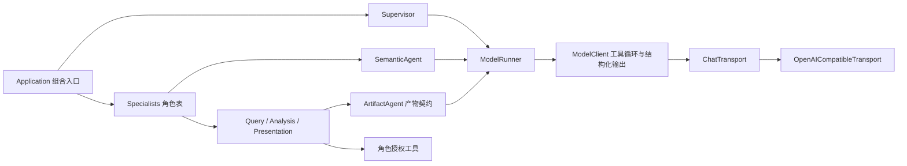

# 当前架构与设计落实映射

实现依据根目录四份设计。旧 agent_system、固定供应商探查、硬编码指标编译器、旧插件装配、LangGraph checkpoint 和对应旧验收脚本已移除。

用户 Query → 初始 Context → Unified Supervisor.Intent → Task Revision → 规划 Context → Supervisor.Planning → 动态 Subtask DAG → Scheduler → Subtask Context → 专业 Agent / Artifact → 按需重规划 → 逐项验收 → 回答 Context → 有序回答 Blocks。

专业 Agent 顺序由 DAG 决定；独立就绪节点并行，普通下游节点不额外调用 Supervisor。节点显式需要重规划或提交建议时，Supervisor 根据原需求判断是否扩展。

| 设计要求 | 实现 |
| --- | --- |
| query.md 四类场景 | agents/supervisor.py；基础问答无 Task，语义知识交 Semantic，问析由 DAG，历史产物用 refs |
| 五个逻辑 Agent | agents/supervisor.py、agents/specialists.py 定义角色；agents/base.py 复用执行与产物契约；agents/prompt.py 管角色指令，agents/tools.py 管工具权限，agents/capabilities.py 管能力说明 |
| 可替换 LLM 调用 | core/model.py 管工具循环和类型校验；core/transport.py 定义 ChatTransport 并实现 OpenAI 兼容适配器；测试可注入脚本适配器 |
| 不增加 Intent/Memory/Chart Agent | Intent 为 Supervisor 阶段，Summary 为存储压缩，图表与报告归 Presentation |
| 四 Store 与七张表 | persistence/stores.py；与账号认证数据库分开 |
| 严格通信骨架 | core/models.py、intent/models.py；Pydantic strict + extra=forbid，需求不强制 operation/metric |
| Query、Intent、完整 Revision | Session 原话/意图事件；application/tasks.py 合并 patch，null 清除，旧版本不覆盖 |
| Request → Subtask | request_ids 校验对应当前需求 |
| depends_on / input_bindings / produced_outputs | 分别保存顺序、逻辑输入、实际命名输出；执行前解析真实来源 |
| Semantic 轻量输出 | Subtask.semantic_binding，不伪装成 query_result |
| 全量数据精确计算 | Artifacts.compute 在隔离内存 SQLite 中只加载输入产物，不接业务库 |
| SQL 安全 | AST 只读、表字段和登记关系校验；业务连接只读，PostgreSQL 有 EXPLAIN 和超时预算 |
| result_xxx 全局命名空间 | Artifact Service 事务生成 ID，四种类型统一编号 |
| Metadata + Content Reference + Full Content | persistence/artifacts.py；所有产物有受管 content_ref，正文不复制进 Event |
| 图表真实图例 | 保存 dataset、series.name、encode、itemStyle.color，页面按真实配置绘图 |
| 五阶段 Context | context/manager.py 的 initial/planning/subtask/replanning/answer |
| 不默认最近任务归属 | last_active_task_id 仅作提示；continue/modify 显式选择并验证目标 Task |
| 大产物按需访问 | inspect/read/compute 工具，分页、总量、精确筛选；小结果可直接注入 |
| 修改只重做受影响工作 | Revision 创建时标记受影响节点和后继，保留仍适用工作及旧产物 |
| 逐项验收 | Application.validate_completion 验证每项需求及其有效执行证据 |
| 用户实际可见回答 | assistant_response.blocks，系统分配 block_id，通过 event/blocks 定位历史回答 |
| 按需 Summary | persistence/summaries.py 追加 covered_to_seq 累积摘要，保留原始事件 |
| 访问范围 | 会话归属用户；产物经 Task 校验；专业 Agent 只访问输入和来源链 |

资源预算来自 core/config.py，不限制业务主题。现有候选业务指标仍需获得发布批准，不能因模型需要而自动升级。示例 DAG 只在 evaluation 夹具中存在。

## Agent 与 LLM 的依赖方向

`ModelRunner` 是 Agent 消费的调用契约；`ChatTransport` 是模型循环消费的厂商传输契约。默认适配器调用 Chat Completions，测试可注入脚本传输或 HTTP 模拟客户端。`ArtifactAgent` 统一核对命名输出、当前节点创建的产物及角色允许的类型；Semantic Agent 保留独立的轻量绑定结果。`Specialists` 的角色覆盖参数允许替换某个专业 Agent，而不修改 Scheduler 或 Supervisor。

参考资料和没有照搬的 DeepSeek Harness 机制见 [Agent 运行时调研](AGENT_RUNTIME_RESEARCH.md)。当前系统不需要动态插件卸载，因此用显式构造注入管理这些替换点。
