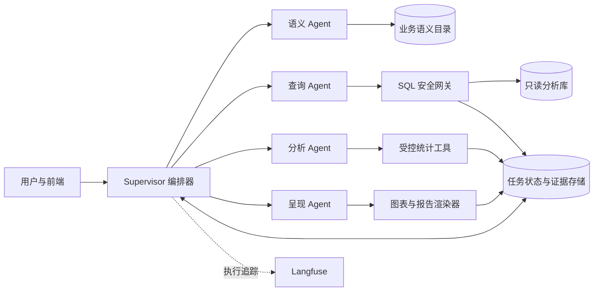
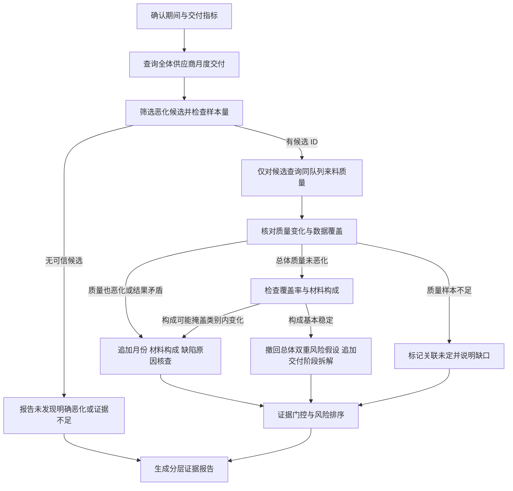
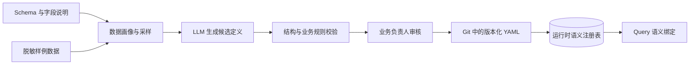

# 企业数据底座智能问析 Agent 系统设计方案

## 1. 目标、依据与范围

本方案面向不熟悉 SQL 的制造业业务人员，提供“自然语言提问 → 定位业务数据 → 受控查询与分析 → 图表和报告”的闭环。系统的关键不在于让模型自由写代码，而在于用可追溯的业务口径、数据权限和验证步骤，把自然语言转为可信的分析结果。

**依据。**《【A07】企业数据底座智能问析 Agent 系统【杭自院】.docx》要求业务知识管理、数据资源理解、自然语言分析、SQL 或脚本生成与执行、结果展示，并提出常见建模能力和可运行原型。`电子供应链数据表说明.md`及 `dataset/` 提供 16 张电子供应链 CSV，合计 62,077 行，覆盖产品、物料、供应商、采购、发货、收货、来料检验、生产用料和库存。本方案以实际 CSV 为演示数据，以题目文档为功能边界。表说明中的数据类型和主键唯一性是对当前文件的描述，导入数据库后仍需正式建约束和校验。

**必须承认的数据边界。** 当前没有设备停机、工序、产线、销售订单或库存历史流水，不能直接演示设备停机与不良率的关系、工序良率、产线最近 7 天趋势、销售收入，也不能用一张库存快照推算库存历史趋势。库存表的统一时间戳为 `2025-12-31 18:00:00`；采购、收货、检验和生产主要是 2024—2025 年历史数据。若按系统当前日期解释“最近一周／月”，多数问题会无结果；界面必须显示实际数据覆盖范围，并在用户未给时间时提示或提供“以所选事实表最新日期为锚点”的明确选项，不能偷偷改写时间条件。未来接入 MES、设备和销售数据后，再开放相应主题。

**实施取舍（YAGNI）。** 第一阶段只建设支撑真实问析闭环的能力：数据目录与业务指标、受控 SQL 查询、描述性分析、图表、简要报告、审计和评测。多 Agent 保持少量、职责清晰；不用通用知识图谱平台、任意代码执行器或全套机器学习流水线。建模能力作为第二阶段的受限任务服务，先验证数据与业务问题是否适合建模。

## 2. 从示例 Query 反推系统能力

以下是设计用问题，不是最终测试题，也不是完整查询语句。示例时间固定在数据覆盖期内；验收要检查口径和证据，而不只检查回答是否流畅。

| 任务级别 | 示例提问 | 拆分任务与验收点 | 反推的能力 |
| --- | --- | --- | --- |
| 简单：数据定位 | “有哪些与来料质量有关的表？`defect_reason` 是什么？” | 找到 `QualityInspections` 及其上游收货明细；解释字段、粒度、取值与来源；不执行事实数据查询也能回答。 | 业务知识与元数据检索、字段说明、关系展示。 |
| 简单：过滤查询 | “列出 2025 年 7 月需要复检的来料检验记录，最多 20 条。” | 按 `inspection_date` 和 `reinspection_required=1` 查询；展示总数、前 20 条、分页和数据日期。 | 意图识别、参数化只读 SQL、结果分页。 |
| 中等：多表关联 | “2025 年上半年各供应商的到货准时率是多少？” | `SupplierShipments.supplier_id → Suppliers.supplier_id`；以发货单为粒度，`actual_arrival_date ≤ expected_arrival_date`；逐供应商返回分子、分母、比率。 | 关系导航、指标口径、时间筛选、可解释 SQL。 |
| 中等：统计与可视化 | “按月看 2025 年上半年来料拒收率，并画趋势图。” | `GoodsReceipts → GoodsReceiptDetails`；以收货日期分月，`Σrejected_quantity/Σreceived_quantity`；检查分母、空月和单位，生成折线图。 | 头明细关联、预聚合、图表规范。 |
| 中等：归因候选 | “2025 年上半年拒收率上升，哪些供应商、材料类别和缺陷原因贡献较多？” | 先确认基期和对比期；分别计算拒收数量及占比，再按供应商、材料类别、原因分解；报告样本量和变化量。结论只称“关联/贡献”，不声称因果。 | 可验收子任务、并行分组计算、口径一致性、保守解释。 |
| 中等：跨域关联 | “采购交期偏差大的供应商，其来料拒收情况如何？” | 通过采购订单、发货单、收货明细、检验记录在可验证的业务键上联结；先分别按发货/收货粒度聚合，再按供应商比较，避免一对多重复计数。 | 跨采购与质量域的关联路径、粒度控制、相关性分析。 |
| 长链路：探索式风险调查 | “2025 年上半年哪些供应商的交付表现明显恶化？这种恶化是否伴随着来料质量下降？找出风险最高的供应商，分析可能原因并给出改善建议。” | 先计算交付趋势和样本量；根据结果选出候选供应商；只对候选追加质量查询；视质量结果再决定是否核查缺陷原因、月份与材料构成；最后区分事实、关联、假设和建议。若没有共同恶化证据，不强行给出“交付与质量双重风险”结论。 | 结果驱动的动态规划、条件分支、证据充足性判断、有限探索和可追溯报告。 |

对“哪个供应商造成了某批生产不良”这类问题，现有数据没有从收货批次到生产工单的消耗批次追溯键。系统应给出可分析的供应商/材料层面关联，并明确无法做批次级因果归属，不应通过同一 `material_id` 强行拼接。

“按预设清单并行取数后生成报表”仍是有用的报告工作流，但不作为本方案的长链路 Agent 代表任务。长链路的验收重点是：下一步查询确实由上一步的结果触发，且能够在证据不支持原假设时改变分析方向或停止。

## 3. 功能设计与题目要求对应

| 模块 | 第一阶段可运行原型 | 与题目要求的关系 | 验收方式 |
| --- | --- | --- | --- |
| 业务知识管理 | 维护业务对象、术语同义词、主题、指标公式、粒度、时间字段、分母与适用范围；版本化发布。 | 覆盖业务对象、指标、规则和分析主题。 | 能查看“到货准时率”“来料拒收率”的定义及修改记录。 |
| 数据资源目录 | 自动导入 16 张表的结构、字段、样例值、行数、时间范围和外键候选；人工审核关系；关系图可浏览。 | 覆盖数据资源理解与展示。 | 从业务词“来料质量”定位相关表和字段；显示来源、粒度。 |
| 自然语言问析 | 识别意图、实体、指标、维度、时间、排序和输出形式；歧义时只问必要问题；展示任务进度。 | 覆盖自然语言分析与 Agent 闭环。 | 完成简单查询、多表统计、异常与长链路简报。 |
| SQL 与计算 | 显示可审阅的 SQL、参数和执行说明；只读查询；统计、分组、同比/环比等确定性计算；受控图表规格。 | 覆盖 SQL/脚本生成、执行、指标计算。 | SQL 可查看、可复跑，数字与数据库结果一致。 |
| 展示与报告 | 表格、折线/柱状/散点等适配图；报告含问题、范围、口径、关键发现、局限、SQL/证据引用，可导出 Markdown/PDF。 | 覆盖图表和简要报告。 | 每个数值结论能追溯到查询结果，图表轴和单位正确。 |
| 安全与可观测 | 用户身份、角色/数据域权限、查询资源限额、审计日志、失败提示、人工反馈。 | 覆盖工程可用性与可靠性。 | 越权、写 SQL、超时、空结果均有明确处理。 |

**建模要求的实现边界。** 题目列举线性回归、决策树、随机森林、逻辑回归、KMeans 和 Isolation Forest，但这 16 张表并没有对每种模型都合适的标签与业务用途。第一阶段提供“建模任务入口和可查看代码”，只允许审批过的数据集、特征和算法模板执行；第二阶段选择一个有业务意义的示例，如用交期偏差、运输费用和来料拒收率做供应商异常提示。无监督异常分数只作排查线索；不把预测、相关性或模型特征重要性写成因果结论。其余算法在有标签、足够样本和明确决策用途时再开放，并显示训练/验证划分、基线、指标和局限。

**界面最小闭环。** 左侧数据与知识目录，中间问答及步骤状态，右侧结果区（口径说明、SQL、数据表、图表、报告）。用户可更改时间、筛选和图表，能对错误口径反馈；不要求用户理解 Agent 内部推理。

## 4. 多 Agent 架构

采用一个受控的 Supervisor 编排器和四类专职 Agent。Agent 负责判断和生成候选方案；身份鉴权、SQL 校验、执行限额和数值核对由确定性服务执行。这样既满足多 Agent 分工，也避免每个步骤都再调用一个“审查 Agent”造成循环。



| 角色 | 输入与输出契约 | 可用权限/工具 | 完成标准与预算建议 |
| --- | --- | --- | --- |
| Supervisor | 输入用户问题、身份和结构化会话摘要；输出初始计划、基于中间结果的下一步决策和最终状态。 | 只可路由、调度、读任务状态；不能直接访问原始表。 | 每个新子任务有触发证据、验收条件和预算；探索任务限制追加轮数与候选数。 |
| 语义 Agent | 输入当前子目标和已发布目录；输出指标/维度/过滤/路径的绑定 IR、歧义与证据。 | 只读语义注册表和业务知识，不读事实明细。 | 所有对象 ID 与版本可解析，粒度与授权路径明确；最多 2 次检索回合。 |
| 查询 Agent | 输入绑定 IR、权限范围与执行限制；输出参数化 SQL、预期列及粒度。 | 只能调用 SQL 预检和只读查询网关。 | SQL 校验通过、结果粒度符合 IR；语法修正最多 2 次。 |
| 分析 Agent | 输入查询结果引用、指标定义和分析目标；输出计算表、候选异常、证据缺口与下一步核查建议。 | 仅受控聚合与统计函数，不能访问任意文件或网络。 | 分子分母、样本量、时间范围、空值处理可核对；下一步建议必须指向可检验假设。 |
| 呈现 Agent | 输入已核对的结果、证据引用和用户格式；输出图表规格、文字结论与报告草稿。 | 图表/报告渲染工具；无数据库执行权。 | 图表与结果一致，报告每条事实有证据；最多 1 次修订。 |

**通信与预算。** 子 Agent 不互相直接呼叫，只向 Supervisor 交回结构化结果。消息至少包含 `task_id`、`status`、`summary`、`artifacts`（结果引用和哈希）、`evidence`（表/指标/查询版本）、`warnings`、`next_action`。Supervisor 维护任务 DAG 与统一事实表，向子 Agent 默认只传当前子目标、相关约束、相关材料引用和输出格式，不传整段聊天记录。原始数据、完整 SQL、图表文件与执行日志存外部存储；消息里放摘要和可回读引用。每个子任务按所用模型分别设输入/输出 token 上限、工具调用次数和截止时间；语义与查询节点优先给较小预算，报告节点按证据量增加预算。超预算时先压缩或回读相关证据，仍不能完成则交回 Supervisor，不允许自行无限续跑。

**何时并行。** 探索式问题先完成全体供应商的交付筛查，再根据结果生成候选 ID 集合；只对这些候选并行执行质量核查。若质量变化需要解释，再按供应商或核查维度并行查询月份、材料构成和缺陷原因。每一阶段之间必须等待上一阶段通过验收，不能在初始计划里对所有供应商预先发出全部查询。并行数由数据库连接和成本预算限制，首版最多 3 个分支。每个 Agent 有独立上下文和工具权限。

**防止循环。** 编排器以 DAG 依赖和状态迁移调度，不允许子 Agent 自行再委派；对“工具名＋规范化参数＋结果哈希”连续重复且任务状态未推进的调用立即熔断。全局限制步骤数、工具次数、耗时和费用。失败最多回到上一层一次，之后给用户可操作的原因，不让多个 Agent 互相要求“再分析一次”。

**为何需要多 Agent，如何验证。** 这里的专业能力、表目录、SQL 权限、统计解释和报告表达需要不同上下文与权限。应做单 Agent 对照实验：同一组简单/中等/长链路问题，在相同模型和数据下比较正确率、SQL 成功率、上下文占用、工具误选、延迟及费用。简单问题可能单 Agent 更快，系统允许 Supervisor 直接回答或单次工具调用；若多 Agent 没有提升复杂问题的质量或稳定性，应继续合并角色，而不是为了架构而拆分。

### 4.1 用 LangGraph 落地编排

项目确定采用 **LangGraph 的 `StateGraph`** 构建主图。Supervisor 是主图里的路由和计划节点，不是一个能随意调用所有工具的“万能 Agent”。四个专业角色封装为独立节点或私有状态子图；每个子图通过输入/输出适配器与主图通信，保留自己的短对话和工具记录，只把结构化结果写回主图。这与 LangGraph 官方的[状态图](https://docs.langchain.com/oss/python/langgraph/graph-api)和[多 Agent 子图](https://docs.langchain.com/oss/python/langgraph/use-subgraphs)机制相符。

主图的节点类型固定，**子任务集合在运行时增长**：`接收/鉴权 → 规则路由 → {直接回答｜澄清｜首轮计划} → 执行 → 观察/证据门控 → {追加探查并回到执行｜生成报告｜停止} → 最终校验`；各执行节点失败时经统一恢复节点转入“修正、重试、重规划、等待用户或终止”之一。单表查询走“语义 → 查询 → 结果”短路径；探索式长链路只预先安排第一轮必要查询，观察节点根据真实结果追加有验收条件的子任务。`Send` 仅在候选集合产生后按候选并行分发，汇合后再次观察；分支写共享结果时按 `task_id` 用确定性 reducer 合并。只有需要“更新状态并决定下一跳”时使用 `Command`；常规路由用条件边，不在同一节点混用动态跳转和静态出边。`Send`、reducer 与 `Command` 的职责见[Graph API 文档](https://docs.langchain.com/oss/python/langgraph/graph-api)。

| 主图状态字段 | 保存内容 | 写入者与规则 |
| --- | --- | --- |
| `request`、`constraints` | 原始目标、时间、输出要求及不可丢失约束 | 入口写入；用户修改后生成新版本。 |
| `route`、`plan` | 执行模式、初始子任务、追加子任务、依赖、触发条件与验收标准 | Supervisor 写入；每次追加记录来源结果、原因和新版本。 |
| `candidates`、`hypotheses`、`evidence_ledger` | 候选供应商、待核查假设、支持/反驳证据及缺口 | 分析 Agent 提议；Supervisor 校验后写入；不存原始明细。 |
| `branch_results` | 按 `task_id` 索引的专业 Agent 输出、状态、证据引用 | 分支只写自己的键；reducer 按键合并并检查重复。 |
| `artifacts`、`warnings` | SQL、结果集、图表、报告的外部引用与告警 | 存引用、版本和哈希，不存完整明细。 |
| `budget`、`exploration_round`、`status` | 已用 token/工具次数/耗时、追加探索次数、当前节点和终止原因 | harness 计数；节点不得自行清零。 |

任务状态使用 `running / waiting_input / partial / completed / failed / blocked` 六种可展示值；每个分支另有自己的状态。`completed` 只能由最终校验节点写入，不能由某个 Agent 自行宣告。

用户身份、租户与权限范围由后端在运行时注入可信 `RunContext`，不接受模型输出或前端参数覆盖；任务状态只存身份引用与授权快照 ID。每次运行绑定稳定的 `thread_id`，生产环境以数据库支持的 checkpointer 保存图状态，跨会话知识与已确认偏好使用持久 Store。开发时可用内存实现，不能把内存实现当成生产持久化。LangGraph 对 [checkpointer 与 store](https://docs.langchain.com/oss/python/langgraph/persistence) 的职责已有明确区分。

仅当缺少关键口径、用户要求人工审阅报告，或进入受限建模流程时使用 `interrupt()` 暂停；用同一 `thread_id` 和 `Command(resume=...)` 恢复。`interrupt()` 所在节点恢复时会从节点开头重新运行，因此该节点不应在暂停前执行非幂等写入；报告落盘等副作用用 `task_id + artifact_type + version` 去重。此处是 LangGraph 的[恢复语义](https://docs.langchain.com/oss/python/langgraph/interrupts)，必须纳入实现测试。

### 4.2 本项目的 Agent harness

这里的 **harness** 指围绕 LangGraph 和模型的应用执行外壳，不另引入一个同名框架。LangGraph 管流程和状态；harness 负责把每次模型决策变成有边界、可追踪、可恢复的执行。设计取其必要部分，避免堆叠插件和通用平台。

| 执行位置 | harness 职责 | 本项目的硬约束 |
| --- | --- | --- |
| 模型调用前 | 按任务装配业务语义、少量工具 Schema、约束清单；估算上下文与输出预算。 | 不把全部表结构、全量工具和原始查询结果放进提示词；超预算先缩减或回读。 |
| 模型输出后 | 校验结构化意图、计划与子 Agent 输出；拒绝缺少粒度、时间或证据的候选。 | 无效输出不能进入 SQL 执行或报告节点；有限次数修正。 |
| 工具调用前 | 工具白名单、JSON Schema、身份权限、SQL AST、成本预估和幂等键校验。 | 即使模型选择了工具，也必须经过后端网关；权限拒绝不能由模型重试绕过。 |
| 工具返回后 | 归一化错误码，保存原始结果并只把摘要/引用写入图状态；更新任务进度。 | 结果集过大分页；空结果与执行失败分开处理。 |
| 循环与恢复 | 按任务计数步数、时间、token、费用和重复调用指纹；检查 checkpoint 后重入。 | 无进展的重复调用熔断；可重试动作必须幂等。 |
| 交付前 | 核验指标版本、SQL/数据版本、图表数据和报告数值，生成证据清单。 | 验证不通过则标记“部分完成/失败”，不能输出看似完整的结论。 |
| 运行后 | 记录节点、模型、工具、错误、延迟、token、费用和用户反馈；对固定题库回放。 | 日志脱敏；同一数据快照可复现，评测区分模型问题与 harness 问题。 |

**最小实现顺序。** 先完成主图、两个受控工具（目录检索、只读查询）、checkpointer 和 SQL 网关，打通一条查询链；再加入并行分支、图表报告、跨会话 Store、上下文压缩和评测。这样每一步都有可运行的闭环。harness 的概念边界可参考[Agent Framework 对执行外壳的说明](https://learn.microsoft.com/agent-framework/agents/harness)，但本项目不依赖该框架的实现。

### 4.3 Langfuse 的使用位置

**职责。** Langfuse 用于观察与评估 Agent 运行：查看 LangGraph 节点、模型调用、检索和工具调用的耗时、token、成本、错误与用户反馈；维护可比较的评测数据集。它不负责 LangGraph 的任务调度、checkpoint、长期记忆，也不替代数据库审计或 SQL 权限网关。首版接入追踪和离线评测即可；Prompt Management 在提示词稳定、需要团队协作发布时再启用。[Langfuse 的 LangGraph 集成说明](https://langfuse.com/integrations/frameworks/langgraph)使用 LangChain `CallbackHandler` 追踪图调用。

| 关联对象 | Langfuse 中记录什么 | 用来回答什么问题 |
| --- | --- | --- |
| 一次用户问析 | 一个 trace；关联脱敏的 `user_id`、`session_id`、`task_id`、任务级别和最终状态 | 这次请求走了哪条路径，在哪里失败或变慢？ |
| Agent/节点 | 路由、语义检索、SQL 草拟、查询、分析、图表、报告的 observation；记录输入/输出摘要、错误码和重试次数 | 是选表错、SQL 错、统计错，还是报告解释错？ |
| 模型调用 | 模型名、提示词版本、token、延迟和估算费用 | 哪个角色耗费最多，压缩是否有效？ |
| 工具与数据版本 | 工具名、参数摘要、SQL 哈希、结果引用、数据快照 ID、指标版本 | 数值结论能否复现，变更后为何不同？ |
| 反馈与评分 | 用户纠错、口径正确性、SQL 安全、数值一致性、报告可读性 | 哪类问题需要修正，发布是否出现回归？ |

**接入方式。** FastAPI 在每次请求开始生成 `task_id`，将产生的 Langfuse trace ID 与任务记录关联；LangGraph `invoke/stream` 的 `config` 中同时传稳定 `thread_id` 与 Langfuse `CallbackHandler`。通过 `propagate_attributes` 传 trace 名称、脱敏用户 ID、会话 ID、环境、任务类型、数据快照与提示词版本。对 SQL 网关、数值核对等非 LangChain 代码增加少量自定义 observation，保证“模型建议 → 安全预检 → 实际执行”的路径可见。Langfuse 写入失败只标记观测降级并报警，不能让查询权限检查失效或阻塞业务结果；待写事件可有限缓冲。[官方示例](https://langfuse.com/integrations/frameworks/langgraph)展示了 callback、属性传播和多 Agent trace 的用法。

最小接线示意（应用启动时应先配置 SDK 凭据和下述 masking；`safe_user_id`、`task_id` 均由服务端生成）：

```python
from langfuse import propagate_attributes
from langfuse.langchain import CallbackHandler

with propagate_attributes(
    trace_name="enterprise-data-qa",
    user_id=safe_user_id,
    session_id=thread_id,
    metadata={"task_id": task_id, "dataset_version": dataset_version},
):
    result = graph.invoke(
        request_state,
        config={
            "configurable": {"thread_id": thread_id},
            "callbacks": [CallbackHandler()],
        },
    )
```

**数据保护。** Langfuse 回调可能自动采集提示词、工具输入和输出，因此默认只发送脱敏摘要、哈希和内部证据 ID，不发送供应商联系方式、原始明细行或完整报告。SDK 出口配置客户端 masking，覆盖框架产生的 OpenTelemetry span；上线前用含手机号/邮箱/敏感字段的样例做泄露检查。Langfuse 中的 `user_id` 使用不可逆内部标识，按环境分项目或标签，设置访问角色与保留期。若企业策略不允许数据出域，采用自建 Langfuse；无论部署位置，原始证据仍留在业务系统。[官方 masking 文档](https://langfuse.com/docs/observability/features/masking)强调在数据离开应用前遮盖。

**评测闭环。** 把人工审核过的简单/中等/长链路问题、预期指标口径、边界场景和数据快照做成版本化 dataset；同一版本上运行单 Agent 与多 Agent、不同提示词或不同语义层配置的 experiment。程序化 evaluator 检查权限阻断、表/字段、时间、分子分母、数值和证据引用；人工或 LLM 辅助评分只评价开放式解释。每个 experiment 记录代码提交、模型配置、提示词与指标版本，防止只比较平均分却无法复现。线上差评 trace 经脱敏、人工确认后加入回归集。Langfuse 官方支持[版本化数据集](https://langfuse.com/docs/evaluation/experiments/datasets)与[SDK 实验](https://langfuse.com/docs/evaluation/experiments/experiments-via-sdk)。

**提示词版本。** 首版提示词留在代码仓库并随版本发布；当业务知识维护人员需要独立调整 Agent 提示词时，才将路由、语义、SQL 和报告提示词迁入 Langfuse Prompt Management。生产读取固定 `production` 标签，发布前在固定数据集上评测，trace 记录实际版本；失败时将标签回退。不要让远程提示词改动绕过代码里的 SQL/权限策略。[版本与标签机制](https://langfuse.com/docs/prompt-management/features/prompt-version-control)支持此流程。

## 5. 任务规划与执行策略

入口先用规则判别权限、是否是元数据问答、是否有明确指标/过滤和是否要求报告；模型仅处理模糊语义与复杂拆解。三种执行模式如下：

| 情况 | 策略 | 原因 |
| --- | --- | --- |
| 术语解释、字段说明；或单表且参数明确 | 直接答复或单次“检索/查询 → 答复”；必要时短 ReAct 纠错。 | 计划成本高于任务本身。 |
| 需要探索表关系或两三步查询，路径尚不确定 | 有界 ReAct：一次检索或执行后观察结果，再选择下一步。 | 允许根据真实元数据修正，同时用步骤预算控制。 |
| 多指标、多域、图表与报告，或用户指定比较/归因链 | 有界 Plan-and-Execute：先规划第一轮必要查询；每轮依据真实结果增加、替换或停止子任务。数据异常、反证和证据缺口都可触发重规划。 | 既能按依赖执行，也不会预先查询所有可能分支。 |

初始计划只写**当前已知且必要**的节点；每个节点有输入引用、产物、验收条件和预算。Supervisor 在观察节点读取中间结果后，才决定追加哪一种查询；追加时记录触发事实、要区分的假设、预期证据和停止条件。重规划既可能由失败触发，也可能由“发现异常/发现反证/样本构成变化”触发。用户改变指标或时间时，对依赖节点失效重算，不重复执行无关分支。

### 5.1 探索式长链路：供应商交付与质量风险

**问题约束。** 对“2025 年上半年明显恶化”，首版给出可修改的默认口径：以 `SupplierShipments.expected_arrival_date` 归入 2025 年 1—3 月和 4—6 月两个交付队列，月度曲线用于定位变化，季度汇总用于筛查以缓解月样本过少。准时率按发货单计数，延期天数为 `max(actual_arrival_date - expected_arrival_date, 0)`，同时展示平均延期天数和各期有效发货数。“质量下降”在此仅由来料拒收率上升作为可观测代理，不等于覆盖全部质量问题或缺陷严重度。这里的“明显”是**业务筛查阈值**，不是未经检验的统计显著性结论；阈值及其版本需展示给用户。



| 阶段 | 当前要解决的问题与数据 | 观察后的条件决策 | 可验收产物 |
| --- | --- | --- | --- |
| 1 交付扫描 | 在 `SupplierShipments` 按供应商/月聚合准时数、发货数、平均延期天数；汇总前后两期。 | 先看样本量和变化方向，不能仅按一个低样本月排序。 | 每个供应商的分子/分母、两期差值、延期变化和数据覆盖。 |
| 2 候选筛查 | 按已发布策略设候选门槛，例如两期各至少 10 单、准时率下降至少 10 个百分点；仅取降幅/延期增长靠前的至多 5 家。 | 无候选则结束共同风险调查；低样本但变化大者列“待观察”，不直接称明显恶化。筛查多家供应商会产生偶然波动，展示不确定性区间并对门槛做敏感性检查。 | 候选 ID、进入/排除原因、阈值版本和中间结果引用。 |
| 3 条件质量查询 | **仅对候选**经 `SupplierShipments → GoodsReceipts → GoodsReceiptDetails` 按同一批发货单的预计到货队列，计算 `Σrejected_quantity / Σreceived_quantity`、明细数、收货覆盖率及简要材料构成。 | 拒收率上升才继续查缺陷原因；总体持平/改善但材料构成改变时检查类别内变化；覆盖不足则标记无法判断。 | 与交付同队列可比的质量变化、构成摘要及缺失数据说明。 |
| 4 交叉核查 | 若质量也恶化、构成可能掩盖类别内恶化或证据矛盾，追加月度变化、类别内拒收率和 `QualityInspections.defect_reason` 分布；若质量确未恶化，则经 `PurchaseOrders.po_id → SupplierShipments.po_id` 比较订单到发货、发货到到货及计划交付窗口的变化。 | 检查变化是否由材料组合、单月极端值、少量明细或计划窗口缩短驱动；只继续执行能区分这些解释的查询。 | 支持/反驳假设的证据表；交付阶段拆解不能直接证明供应商内部或承运商根因。 |
| 5 风险结论 | 只用经过校验的交付和质量结果排序：先区分“双域恶化”“仅交付恶化”“质量未定”，同组内按交付降幅、延期增长及质量变化透明排序。 | 排序规则须由业务方发布，不定义 LLM 即兴的黑箱综合分；若没有双域恶化者，就明确说没有该类高风险供应商。 | 事实、关联发现、待验证假设、建议分别列示并引用证据。 |

**为什么这样接表。** 交付期以预计到货日形成发货单队列；质量要追到这些发货单对应的收货明细，不能分别按“发货月”和“检验月”汇总后直接比较，否则跨月到货会造成错配。收货覆盖率定义为队列中有收货单的不同发货单数 / 队列发货单数。缺陷原因经 `GoodsReceiptDetails.gr_detail_id → QualityInspections.gr_detail_id` 读取；若一个收货明细对应多条检验记录，先在明细粒度预聚合，避免放大收货量。材料类别经 `GoodsReceiptDetails.material_id → Materials.material_id` 取得。交付拆解的订单到发货天数、运输到货天数、计划交付窗口分别由 `ship_date - order_date`、`actual_arrival_date - ship_date`、`expected_arrival_date - order_date` 计算；这些是阶段时长，不直接等同责任归因。所有路径在语义注册表中验证后才开放。

**数据中的反证示例。** 对现有 CSV 做预检，2025 年上半年按预计到货日共有 678 张发货单；25 家供应商中，17 家在两个季度均有至少 10 单，因此月度图不宜直接代替季度筛查。供应商 ID `11` 前后两期准时数为 `8/10` 与 `4/10`，交付筛查会将其列为候选；但同队列收货明细的总体来料拒收率约为 `2.93%` 与 `1.99%`，**总体数据不支持质量同步下降**。后续节点应核查材料构成是否掩盖类别内变化；若没有相反证据，再撤回“双重恶化”假设并转为交付专项风险分析。该数字只用于检验工作流分支，正式系统仍须从冻结数据快照重算并附 SQL 与指标版本。

**动态规划契约。** 分析 Agent 可提出 `next_probe`，内容为候选 ID、待区分假设、所需指标/维度、预期能改变的结论、最低样本要求和估计成本；Supervisor 只批准能填补当前证据缺口且符合权限/预算的探查，再将其变成新 DAG 节点。LangGraph 用条件边或 `Command` 按观察结果路由，用 `Send` 并行处理不同候选供应商，结果按 `task_id` 汇合。每次追加都写入 `plan_version`、`trigger_result_ref` 和决策原因，Langfuse trace 可展示为何查了这家供应商、为何没有查其他供应商。

第一轮交付筛查后，追加任务的结构化示意如下；它是一项**待批准探查**，不是预先排好的固定查询：

```json
{
  "trigger_result_ref": "delivery_screen_result",
  "candidate_supplier_ids": [11],
  "hypothesis": "同一发货单队列的来料拒收率也上升",
  "probe_metric": "incoming_reject_rate@1.0.0",
  "cohort_field": "SupplierShipments.expected_arrival_date",
  "compare_periods": ["2025-01-01/2025-04-01", "2025-04-01/2025-07-01"],
  "acceptance": ["收货覆盖率达到已发布门槛", "各期显示分子分母和发货单数"],
  "if_increase": "核查材料构成与缺陷原因",
  "if_not_increase": "先检查材料构成；无掩盖迹象则撤回双域假设并拆解交付阶段时长",
  "if_insufficient": "标记质量关联未定并停止该假设"
}
```

**停止与报告门控。** 首版最多两轮追加探索、每轮至多 5 个候选，且总工具/时间预算仍受 harness 约束；没有可信候选、下一次查询不能改变结论或证据/预算不足时停止。总体质量改善但构成变化尚未核查时，只能说“总体拒收率未上升”，不能下更广的质量结论。质量反证经核查明确后，停止**双重风险**分支；若用户还要求分析交付恶化原因，可进行一次交付阶段拆解。报告必须区分：①已核验事实（准时率、延期、拒收率和样本量）；②同队列中可观察的关联；③无法由现有数据验证的原因假设（如供应商排产、运输问题）；④与证据相称的建议（交期复盘、供应商沟通；仅有质量风险证据时才建议专项抽检）。没有运输承运商、供应商内部过程数据时，不得声称找到了根因。

## 6. 数据语义建模与受控分析

### 6.1 最小语义层

不把整个 CSV 文档直接交给模型。导入时建立可检索的五类对象：

1. **表与字段卡片**：中文业务名、原名、类型、描述、敏感级别、样例、时间范围、行数、更新时点、数据源版本。
2. **关系卡片**：连接键、基数、允许的联结路径、主表与明细表粒度、是否经过人工验证。例如 `PurchaseOrders.po_id → SupplierShipments.po_id → GoodsReceipts.shipment_id → GoodsReceiptDetails.gr_id → QualityInspections.gr_detail_id`；生产用料经 `ProductionDetails.bom_id → ProductBOM.bom_id` 关联产品与材料，但需检查 BOM 与工单产品一致。
3. **业务对象与主题**：供应商、采购订单、发货、收货、检验、生产工单、物料库存；交付、来料质量、生产用料、库存风险四个主题。
4. **指标卡片**：名称/同义词、公式、事实表、记录粒度、时间字段、适用筛选、零分母规则、展示单位、版本和审批人。
5. **分析限制卡片**：缺失域、不可做的因果/批次推断、金额币种未知、库存为单一快照、混合日期格式等。

语义对象分为 `candidate`（机器建议）、`reviewed`（通过自动检查、待业务确认）、`published`（可用于生产问析）、`deprecated`（禁止新任务使用）。运行时只绑定当前授权范围内的 `published` 版本。新数据源可以自动发现结构，但不能把推断出的关系和业务口径直接发布。

### 6.2 自动化建模流程：从 Schema 到候选定义

每次导入或更新数据源，先运行一次离线建模流水线，而不是每次用户提问都让 LLM 从头理解 16 张表：



1. **扫描物理结构。** 读取表名、列名、数据库类型、主键/外键约束、视图权限和数据源版本。CSV 场景先推断类型并标记“推断值”，不能把样本中的唯一性当成数据库约束。
2. **生成数据画像。** 对每列计算行数、空值率、去重数、最小/最大值、日期范围和高频枚举；每表至多取少量脱敏样例，兼顾随机记录、稀有枚举和异常值，不把整表交给 LLM。对疑似键做唯一性、引用覆盖率和联结基数检查。例如 `GoodsReceiptDetails.gr_id` 候选连接 `GoodsReceipts.gr_id`，还要验证是否确为多对一。
3. **结合已有说明检索。** 优先读取 `电子供应链数据表说明.md` 的字段含义、粒度和限制；对没有说明的字段才让 LLM 在 Schema 与采样上下文中提出中文名称、同义词、主题、关系和指标候选。提示词要求每条候选输出精确字段引用、证据位置、推断依据、置信度和“需要业务确认”的问题，禁止创造不存在的列。
4. **程序化验证候选。** 用 JSON Schema 校验格式，再逐项核对表/字段存在、类型匹配、关联键覆盖率、联结后的粒度、聚合表达式合法性、时间字段可用性和权限。生成测试查询，检查分子/分母、零分母、日期解析、行数膨胀和典型过滤结果。验证失败的候选回到草稿，不进入运行时目录。
5. **业务审核与发布。** 数据负责人确认业务对象和关系，质量/采购等领域负责人确认指标口径、入期日期、分母、可拆分维度与限制；批准后赋不可变版本并发布。未确认的“拒收率”“良率”等只能作为候选显示，Agent 不得当作正式指标回答。
6. **增量维护。** 新快照与旧 Schema/画像做差异；字段删除、类型变化、关联基数漂移、指标公式变更会沿依赖图找出受影响对象，暂停其发布状态并重新验证。仅样例值变化不自动改动业务口径。候选生成是离线作业，只能写草稿区；在线语义 Agent 仍保持只读权限。

**指标卡片从哪里来。** 它不是 LLM 凭空生成的公式：数据表说明给出字段含义和记录粒度，Schema/画像证明字段与关联路径是否真实可用，LLM 从常见业务模式提出候选，业务负责人最终确定定义。以“来料拒收率”为例，`GoodsReceiptDetails` 同时有收货量与拒收量，适合提出 `Σ拒收量 / Σ收货量`，而非逐行比率的简单平均；`GoodsReceipts.receipt_date` 可作收货时间，`GoodsReceiptDetails.gr_id → GoodsReceipts.gr_id` 可取得该时间。但“按收货日入期”“分母包含哪些记录”“是否按供应商拆分”都需要审核。样本中出现某种数值关系，也不能自动推定全量业务规则。卡片保留这条来源链，供后续解释与审计。

### 6.3 语义配置规范、版本和依赖

**单一编辑源。** 首版用 Git 管理 YAML 定义，借助 JSON Schema 或等价模型校验结构；发布程序把已批准版本投影到 PostgreSQL 的 `semantic_object`、`semantic_relation`、`semantic_dependency` 等只读运行表并建立检索索引。YAML 便于审核和差异查看，数据库便于运行时按权限与版本检索；两处不能各自独立编辑。每个对象含稳定 ID、类型、命名空间、版本、状态、所有者、来源证据、创建/批准时间和变更说明。版本一经发布不可原地修改，运行任务固定引用具体版本，而不是随时读取“最新”。

| 对象类型 | 除通用字段外的必填配置 | 依赖关系 |
| --- | --- | --- |
| 表/字段 | 物理数据源、列名、规范类型、中文说明、敏感级别、时间覆盖/更新时间 | 数据源 Schema 版本。 |
| 关系 | 左右表列、连接方向、基数、引用覆盖率、验证状态 | 两端字段版本。 |
| 维度 | 输出类型、取值或时间粒度表达式、起始事实表、允许的关联路径 | 字段和关系版本。 |
| 指标 | 事实表、记录粒度、时间字段、聚合 DSL、零分母规则、单位、可用维度、限制 | 字段、关系、维度及其他指标版本。 |
| 主题/术语 | 名称、别名、相关对象和适用业务场景 | 被引用对象版本。 |

发布后的指标定义示意（字段名均来自当前数据集，维度和关系须在独立配置中有已发布定义）：

```yaml
id: incoming_reject_rate
type: metric
version: 1.0.0
status: published
name: 来料拒收率
aliases: [来料拒收比例]
fact: GoodsReceiptDetails
grain: GoodsReceiptDetails.gr_detail_id
time_field: GoodsReceipts.receipt_date
time_relation: grd_to_gr
expression:
  operator: ratio_of_sums
  numerator: GoodsReceiptDetails.rejected_quantity
  denominator: GoodsReceiptDetails.received_quantity
zero_denominator: null
format: percent
allowed_dimensions: [receipt_month, material, supplier]
dependencies:
  columns: [GoodsReceiptDetails.rejected_quantity,
            GoodsReceiptDetails.received_quantity,
            GoodsReceiptDetails.gr_id, GoodsReceipts.gr_id,
            GoodsReceipts.receipt_date]
  relations: [grd_to_gr]
  dimensions: [receipt_month, material, supplier]
source_evidence: ["电子供应链数据表说明.md::GoodsReceipts",
                  "电子供应链数据表说明.md::GoodsReceiptDetails"]
```

配置中的表达式是受限 DSL，不接受任意 SQL。`grd_to_gr` 在关系注册表中定义左右键、基数 `many_to_one`、允许方向和验证结果；`supplier` 维度另声明 `GoodsReceiptDetails → GoodsReceipts → SupplierShipments → Suppliers` 的已验证路径及权限。若允许某个维度必须增加新关系，就把该关系加入该维度的依赖，而不是让模型临时猜 JOIN。以上 YAML 是设计示例，表示业务审核后的目标形态，并不声称当前项目已完成审核。

**版本与失效。** 指标依赖字段、关系、维度和其他指标；发布时把 YAML 的逻辑引用解析为对象 ID 与具体版本，写入不可变发布清单和依赖表，形成可查询的有向图。字段重命名或关系变更时，先定位受影响的指标和报表，运行回归查询与口径检查，再发布新版本；旧报告保留旧版本与数据快照引用。业务定义修改通常升级指标版本；仅展示名称/描述修订也要留变更记录。LangGraph 的 Store 存用户偏好和语义版本引用，不替代语义注册表；Langfuse 记录运行时实际引用的语义版本，便于比较。

### 6.4 运行时语义绑定：从问题到查询路径

1. **解析提问。** 规则识别明确日期、排序、数量限制和业务实体，LLM 只把模糊表达转换为结构化意图：候选指标、维度、过滤条件、时间范围、粒度、输出形式及未解歧义。原文保留，不直接生成可执行 SQL。
2. **召回并筛选。** 数据库检索、关键词匹配或向量检索。 从已发布目录按名称/同义词、主题和字段描述找候选。多个口径都可能成立时提出具体澄清；缺少正式指标时可说明可用原始字段，并要求用户确认临时计算口径。
3. **绑定查询计划。** 选定指标版本后，将用户的“按月、按供应商、2025 年上半年”绑定到 `receipt_month`、`supplier`、`GoodsReceipts.receipt_date` 的闭开日期区间。关系规划只遍历已发布、权限允许且基数可控的路径；从指标事实表粒度出发，选择能够连接全部维度的路径。若有多条路径、跨一对多联结或粒度无法保持，则要求澄清或先预聚合，不能只选最短路径。
4. **生成与执行。** 形成与自然语言无关的绑定 IR。已发布指标优先由确定性编译器生成参数化 SQL；临时分析才由受限查询 Agent 提出 SQL 候选。两者都须经过 AST、权限、扫描成本和粒度预检才执行。最终结果附指标 ID/版本、维度与过滤、时间解释、联结路径、SQL 哈希、数据快照和告警，供图表与报告复用。

各 Agent 对同一语义包只读取所需部分：语义 Agent 使用术语、指标、维度和关系作绑定；查询 Agent 使用绑定 IR、字段类型与允许路径生成查询；分析 Agent 使用公式、粒度、零分母规则和限制核验统计；呈现 Agent 使用业务名称、单位、口径说明及证据引用组织图表和报告。Supervisor 传递对象 ID、版本和必要摘要，各 Agent 需要细节时按 ID 回读，防止同一指标在不同步骤被重新解释。

例如提问“按供应商比较 2025 年上半年的月度来料拒收率”，绑定结果可表示为：

```json
{
  "metric": "incoming_reject_rate@1.0.0",
  "dimensions": ["supplier", "receipt_month"],
  "filters": [{"field": "GoodsReceipts.receipt_date", "op": ">=", "value": "2025-01-01"},
              {"field": "GoodsReceipts.receipt_date", "op": "<", "value": "2025-07-01"}],
  "fact_grain": "GoodsReceiptDetails.gr_detail_id",
  "join_path": ["grd_to_gr", "gr_to_shipment", "shipment_to_supplier"],
  "output": "table_and_chart"
}
```

这份 IR 的每个 ID 都必须能在已发布语义目录中解析，且路径上的表列都在用户授权范围内。若用户问“最近一个月”，应先按第 1 节的时间规则解释或澄清；若问“按工序看良率”，目录检索应明确当前数据没有工序对象，不能映射到相近的来料检验字段。语义绑定的成功标准是“指标、维度、过滤、粒度、路径和来源均可解释”，而非仅返回一段可运行 SQL。

### 6.5 首批指标与口径风险

| 指标 | 建议定义与粒度 | 必须展示的限制 |
| --- | --- | --- |
| 发货到货准时率 | 以 `SupplierShipments.shipment_id` 为粒度，`actual_arrival_date ≤ expected_arrival_date` 的发货数 / 有效发货数。 | 探索式交付任务按预计到货日形成队列；按实际到货日分析需另行明确，不混用。没有运输异常原因，不能解释根因。 |
| 平均延期天数 | 以发货单为粒度，逐单计算 `max(actual_arrival_date - expected_arrival_date, 0)` 后求平均，同时展示有效发货数。 | 准时或提前到货计 0 天；需显示均值受极端值影响，必要时补充分布或中位数。 |
| 来料拒收率 | 以 `GoodsReceiptDetails.gr_detail_id` 为粒度，`Σrejected_quantity / Σreceived_quantity`。 | 以 `GoodsReceipts.receipt_date` 入期；勿将 `QualityInspections.defect_quantity` 与拒收数量直接相加。 |
| 缺陷原因贡献 | 以检验记录为粒度，按 `defect_reason` 汇总 `defect_quantity`，并展示占总缺陷数比例。 | “No Defect” 排除在缺陷分解外；这只是记录原因分类。 |
| 生产延期工单占比 | 以 `Production.production_id` 为粒度，`actual_end_date > expected_end_date` 的工单数 / 有实际完工日的工单数。 | `Production` 当前记录为已完成工单；不等同全体在制订单履约率。 |
| 可用原料库存 | 对 `RawMaterialInventory` 各仓库、物料记录计算 `quantity_on_hand - quantity_reserved`。 | 仅为 2025-12-31 快照；单位沿用物料单位，不能当作当前实时库存。 |

生产表的 `production_quantity` 是否包含 `rejected_quantity` 未明确，暂不发布“生产良率”指标；金额字段币种及税额口径未提供，暂不跨表汇总成统一财务结论。`ProductBOM` 无版本生效时间，不用当前 BOM 回推历史配方变更。数据导入时统一解析 `YYYY-MM-DD` 与 `YYYY/M/D` 日期，并保留原字段和转换质量报告。

**避免重复计数。** SQL 生成前记录每一步的期望粒度与联结基数。单头金额先在单头粒度汇总，不能直接联结多条明细再求和。多个一对多分支要分别预聚合到共同键，再合并。执行后检查 `COUNT(DISTINCT 主键)`、行数膨胀比和聚合总量；超过阈值时阻断并提示重写。

## 7. 工具调用、失败恢复与安全

### 7.1 工具目录与执行链

首版只暴露五类统一接口：`search_catalog`（找表、字段和指标）、`inspect_schema`（取精简结构/关系/样例）、`validate_query`（解析与权限检查）、`run_readonly_query`（受限执行）、`compute_and_render`（受控计算、图表和报告）。按任务动态加载工具描述：先给类别和简短能力，选中后再加载必要参数 Schema。高度相近的目录工具合并，避免大量工具说明挤占上下文。

调用链为：选择工具 → 根据 JSON Schema 校验必填字段、枚举、日期和类型 → 绑定用户身份与数据范围 → 工具预检 → 执行 → 结构化结果/错误码 → Supervisor 决策。查询返回列名、类型、总行数、前 N 行、统计摘要与结果引用；大聚合在数据库/程序侧完成，禁止模型在上下文里手算大表。原始结果存储并可按引用分页回读。固定系统提示词、工具 Schema 和语义目录版本可用 prompt cache 降成本，但权限与实时数据不进可跨用户复用的缓存。

| 失败类别 | 处理策略 |
| --- | --- |
| 参数/SQL 语法错误 | 返回字段级错误，查询 Agent 最多修正 2 次；仍失败则展示问题和可查看 SQL。 |
| 临时服务错误 | 仅对幂等只读工具做指数退避与抖动，最多 2 次；记录重试，不重复产出报告。 |
| 权限拒绝 | 立即停止，不交给模型“换一种 SQL 试试”；告知无权访问的资源类别，不泄露表内容。 |
| 工具路由错误 | Supervisor 根据错误码改选同类受许可工具一次，并记录原因。 |
| 业务结果为空 | 先区分正常零结果与时间范围/字段口径问题；展示数据覆盖范围，可建议用户调整条件，但不自动放宽条件。 |
| 查询超时/超量 | 终止执行；建议缩小时间、维度或先聚合，不把未完成结果写入结论。 |

### 7.2 SQL 与脚本权限边界

- CSV 先经校验导入 PostgreSQL 分析库；应用账号只授予白名单视图 `SELECT`，数据库层强制只读事务，禁止 DDL/DML、系统表、外部函数和多语句。数据域/行列权限由后端鉴权并在数据库视图或行级策略再次执行；前端和模型均不能指定越权身份。
- 对模型生成的 SQL 做 AST 解析，限定为单条 `SELECT`、允许的表/列/函数/联结关系和参数占位；设置最大扫描量、行数、执行时间、并发和成本。`EXPLAIN` 预估通过后才执行。不能仅靠提示词或正则做权限控制。
- 个人联系方式等字段默认从问析视图隐藏；目录可显示“存在该字段”及敏感标记，不返回原值。日志记录用户、任务、指标版本、SQL 哈希、数据版本、执行时间与结果引用，避免记录不必要的明文数据。
- 用户可查看生成的 SQL 与分析代码。首版的“脚本执行”仅执行受控模板或沙箱内的已批准统计/建模函数，输入为查询结果引用；沙箱禁网络、限 CPU/内存/时间和文件访问。任意 Python 代码不开放给业务用户。图表采用结构化规格（数据引用、图型、轴、单位）经渲染器生成。
- 报告输出前执行数值一致性检查：图表数据集哈希、分子分母、时间范围和报告引用必须指向本次有效产物；数据或语义定义更新后标记旧报告版本，不悄然改写历史结论。

### 7.3 异常链路的兜底设计

**统一错误契约。** 每个节点只返回结构化成功结果，或返回 `error_code`、`stage`、`retryable`、`attempt`、`safe_message`、`evidence_refs`、`checkpoint_ref`。harness 把错误划为五类：①可自动重试的临时故障；②模型可修正的语法/参数故障；③需要用户补充口径；④权限或安全阻断；⑤不可恢复的系统/数据故障。Supervisor 根据类别和剩余预算走固定边，不让模型自由决定是否绕过安全检查。最终响应须包含状态、已完成内容、未完成内容、原因和可执行的下一步。

| 异常发生处 | 发现与恢复路径 | 最终兜底与用户可见结果 |
| --- | --- | --- |
| 意图、时间或指标不明确 | 对关键歧义进入 `waiting_input`，通过 `interrupt()` 提一个具体问题；非关键格式偏好采用默认值并标注。 | 用户未回答时保留 checkpoint，不执行依赖该口径的 SQL；不猜测时间和指标定义。 |
| 元数据检索无表或关系未获验证 | 回查数据目录一次；仍无可用路径则标记该分支 `blocked`。 | 说明缺少的表、字段或关联键；可给出已有数据能回答的较窄问题，不能拼造跨表关系。 |
| 模型超时、限流或结构化输出无效 | 临时错误按节点重试策略退避；结构化输出最多修正两次；有批准的备用模型时可在相同约束下切换一次。 | 无法生成可信查询时停止该分支；可返回已经核验的元数据，不生成猜测性数值。 |
| SQL 参数、语法或计划成本失败 | 查询 Agent 按预检错误修正最多两次；成本超限先建议更窄范围或预聚合。 | 不自动删除用户筛选条件或放宽权限；展示可审阅的失败说明和建议。 |
| SQL 权限拒绝、注入或写操作 | 安全网关直接返回 `blocked`，不进入重试/备用工具路径。 | 仅说明访问受限或操作不允许；不泄露敏感字段、视图名或被拦截的数据。 |
| 数据库临时断连、查询中断 | 只读幂等查询有限重试；超时后终止连接并核对是否产生完整结果引用。 | 没有完整结果就不写数值结论；可保留此前已核验分支并提示稍后重试。 |
| 查询成功但零行、零分母或数据过期 | 区分正常业务零结果、日期超出覆盖范围和数据质量异常；记录事实表的有效时间与样本量。 | 返回“无符合条件数据”或“指标不可计算”，不把零行当作 0% 指标，也不擅自改用历史日期。 |
| 联结膨胀、口径冲突或统计校验不通过 | 分析节点阻断该指标；按已批准的粒度/口径重算一次，并保留失败证据。 | 仍不一致则该分支 `failed`，不进入报告事实区；可输出数据质量提示。 |
| 图表或报告生成失败 | 图表渲染失败则展示经核验的结果表；叙述生成失败则用固定模板列出指标、范围和证据。 | 只降级展示形式，不降级数值校验；明确标记缺失的图表或报告段落。 |
| 并行分支部分失败 | 汇总节点检查计划中的“必需/可选”分支及每条证据状态。 | 可选分支失败可生成标注缺口的 `partial` 报告；必需分支失败则不生成声称完整的报告，只交付已核验部分。 |
| checkpoint 或业务审计不可用 | 长链路任务暂停派发；先确认任务是否已执行及结果是否有持久引用。 | 不做无法恢复、无法审计的 SQL 执行；返回系统暂不可用。Langfuse 不可用仅使观测降级，不能替代业务审计。 |

**重试与恢复边界。** LangGraph 的节点重试会从节点开头重新执行，checkpoint 通常在图的步骤边界保存，不保证外部副作用“恰好一次”。因此以 `task_id + node_id + input_hash + data_version` 为查询/计算的幂等键；报告文件以版本化路径或唯一键写入，重试先查已有产物。若数据库调用超时但未收到确认，先查询执行记录和结果引用，将状态记为 `unknown`，不能假定一定失败而盲目重复。恢复时校验数据快照、指标版本、权限快照和用户约束是否仍有效；若已变化，旧分支标为失效并重算相关依赖。LangGraph 的[故障容忍文档](https://docs.langchain.com/oss/python/langgraph/fault-tolerance)说明了节点重试、超时和幂等边界。

**预算与熔断。** 在 LangGraph 中对外部模型/工具节点配置 `retry_policy`、节点超时和重试耗尽后的 `error_handler`，把异常转成上述统一错误契约；业务零结果是正常返回，不抛成可重试异常。总任务预算优先于局部重试。连续两次相同“工具＋参数＋结果哈希”且状态未推进，或超过全局时间/费用上限，直接熔断到 `partial/failed`。备用模型、备用工具、动态重规划各最多一次，且每次必须说明新路径能解决原错误；权限错误和数据缺失不允许用这些路径规避。

**故障注入验收。** 在固定数据快照上人为触发：模型 429、检索超时、非法 SQL、权限拒绝、数据库超时、空结果、重复联结、并行一支失败、渲染失败、checkpoint 故障和 Langfuse 故障。逐例检查最终状态、用户提示、重试次数、未重复写入、SQL 未越权、报告没有无证据结论；Langfuse trace 记录实际执行路径，业务审计独立验证关键动作。全部异常路径纳入回归题库，不只测试成功链路。

## 8. Memory、上下文管理与压缩

**短期状态。** LangGraph 主图以数据库 checkpointer 按 `thread_id` 持久化 `task_id`、用户目标、约束清单、计划 DAG、事实与证据索引、已完成节点、失败与待办；支持中断恢复和幂等重试。对话原文保留为可回读记录，但 Agent 默认只读取结构化摘要和与当前节点相关片段。生产可采用 `PostgresSaver`，初始化时执行所需的存储设置；具体版本与包在实现时锁定。

**跨会话 Store。** LangGraph 持久 Store 存放用户已确认的项目约定、报告模板偏好、经批准的可复用查询，以及所引用的语义版本 ID；已发布指标的完整定义由第 6.3 节的语义注册表管理。偏好优先级为“本项目当前约定 > 已确认的长期偏好 > 系统默认”；按租户、项目和用户命名空间隔离。每条记忆记录内容、来源、创建/修订时间、置信度和作用范围，支持查看、覆盖、撤销。不确定的偏好只保存为低置信度候选，不自动升格为长期规则。敏感数据结果不作为长期记忆。生产可选 `PostgresStore`，与任务 checkpoint 分开管理保留期。

**如何知道上下文快满。** 不能只等模型报错。每次调用前用模型对应的 tokenizer 估算：系统指令＋工具 Schema＋当前消息＋检索片段＋预留输出；同时读取模型服务返回的实际 `input_tokens/output_tokens`，维护估算偏差。以模型窗口减去计划输出和安全余量得到输入预算。建议在约 70% 开始减少无关检索和工具描述，85% 触发分层摘要/按需回读，接近硬上限则阻止调用并拆任务；阈值需按具体模型与结果调校。上下文超限报错是最后一道信号，不是正常调度机制。

**压缩策略。** 先裁剪工具原始结果（保留总数、关键列和引用），再只检索相关知识片段，之后把旧对话压成“目标、约束、事实及来源、关键决策及原因、完成/待办、失败、证据引用”。可丢弃重复表述、已推翻的猜测、可回读的长原文和无关闲聊。压缩前后用不可丢失的**约束清单**逐项比对：时间范围、权限、指标口径、用户指定输出、禁止事项、待澄清问题；缺项就回读补齐，不继续执行。

**压缩是否有效。** 对长任务样本记录压缩率、窗口占用与超限次数，同时测约束保留率、事实/数值保留率、证据引用可解析率、最终任务正确率和用户纠错次数。关键约束与数值用程序化检查，开放式摘要可由人工抽样或 LLM 辅助评分，但 LLM 分数不能替代来源核对。若节省 token 却降低任务正确率，则调整压缩粒度或增加回读。

## 9. 评测与验收

建立固定的题库和数据快照，覆盖简单、中等、长链路三档，以及数据缺失、无结果、歧义、越权和恶意 SQL 诱导。题库中的预期结果由人工审核的 SQL/口径生成，示例 Query 不直接充当最终测试集。评测包含：

| 维度 | 可执行检查 |
| --- | --- |
| 结果正确性 | 指标公式、分子分母、时间、粒度、数值与图表和报告一致；缺失数据时正确拒答或说明。 |
| 语义建模与绑定 | 候选定义的字段存在率、关系基数验证、人工审核一致率；运行时指标/维度/过滤/路径与黄金标注一致，旧版本依赖变化能正确失效。 |
| 过程质量 | 路由与计划是否合适；表/字段/联结路径是否有证据；重规划是否由中间结果触发；无候选时是否停查、候选之外是否避免质量查询、质量反证后是否撤回原假设。 |
| 可靠性与效率 | SQL 成功率、任务完成率、超时率、平均/尾部延迟、token 与工具调用成本、上下文压缩后的成功率。 |
| 安全与边界 | 写 SQL、越权字段、跨用户缓存、提示注入、重复调用循环均应被阻断；无法支持的因果推断不装作事实。 |
| 用户体验 | 业务用户能否理解口径、修改筛选、查看 SQL、找到报告证据及失败原因；通过小规模可用性任务测试。 |

开放式报告由人工盲评或 LLM 辅助检查清晰度与可读性；事实、约束、数据引用和数值一致性必须程序化判定。长链路评测增加三类过程断言：`无候选→不进入质量分支`、`质量改善→不输出双域恶化结论`、`质量恶化但构成变化→追加核查或降低结论强度`。不要求每次 Agent 走完全相同的节点序列，但必须满足这些决策不变量。至少进行三组消融：单 Agent 与多 Agent、无语义层与有语义层、无/有上下文管理。通过 Langfuse dataset/experiment 记录同一题目、模型、数据快照和权限下的对照 trace 与评分。首版验收建议设为：代表性题库的关键数值与口径无错误，所有越权和写操作被拒绝，长链路报告可回溯到表、SQL 和指标版本；具体百分比目标在首轮基线测完后确定，避免凭空承诺。

## 10. 交付路线与原型演示

| 阶段 | 工作与完成标志 |
| --- | --- |
| 0 数据与语义准备 | 导入 16 张 CSV，运行 Schema 扫描、画像、候选定义生成和程序校验；人工审定 4 个主题、关系及首批指标，发布 YAML 版本与数据库投影。完成后冻结演示数据和语义版本。 |
| 1 最小闭环 | 完成目录、语义检索、Supervisor、只读 SQL 网关、表格/图表/简报、审计和 Langfuse 基础追踪；以“供应商准时率”“来料拒收率”打通基础链路，并实现“交付筛查→候选质量核查→条件报告”的探索主路径。 |
| 2 稳定性与评测 | 增加构成变化核查、失败恢复、上下文压缩、权限测试、Langfuse 版本化题库/实验、单 Agent 对照和业务用户试用；据结果调整角色与预算。 |
| 3 条件扩展 | 数据和业务定义齐备后，增加受控建模服务、更多主题和外部业务系统；新域须重新审核指标、权限和评测集。 |

**推荐实现。** PostgreSQL 存分析表、语义目录、LangGraph checkpoint 与长期 Store；Python/FastAPI 承载 LangGraph 主图、harness、SQL 安全网关与统计服务；Vue 或 React 实现问析界面；图表库生成可导出图表。Langfuse 承载追踪与实验，数据库审计仍保留在业务系统。模型服务通过统一适配层接入，按隐私、成本和效果选择具体供应商。首版自行部署图应用与数据库；Langfuse Cloud 或自建由企业数据策略决定，不依赖托管 Agent Server。

**演示顺序。** 先查看“来料拒收率”定义和关联表 → 提出简单查询 → 提出按供应商/月份统计并查看 SQL 与图表 → 提出第 5.1 节的交付与质量风险问题，观察“交付结果产生候选→仅候选进入质量查询→依据反证改变结论”的 LangGraph 与 Langfuse 轨迹 → 输入设备停机问题，展示“当前数据不支持”的边界反馈。提交时将本方案扩充为题目要求的项目详细方案，并配套产品使用手册、业务知识说明、数据资源说明、演示视频、PPT 与团队过程记录。

## 参考材料

- `【A07】企业数据底座智能问析 Agent 系统【杭自院】.docx`：任务背景、技术要求与评分要点。
- `电子供应链数据表说明.md`：16 张表的字段、粒度、规模、样例和日期范围。
- `dataset/*.csv`：演示数据；数据边界以导入校验和后续业务确认结果为准。
