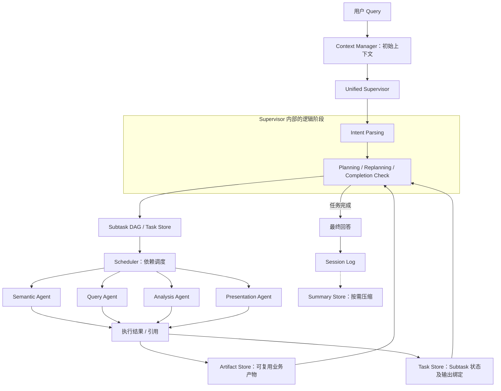
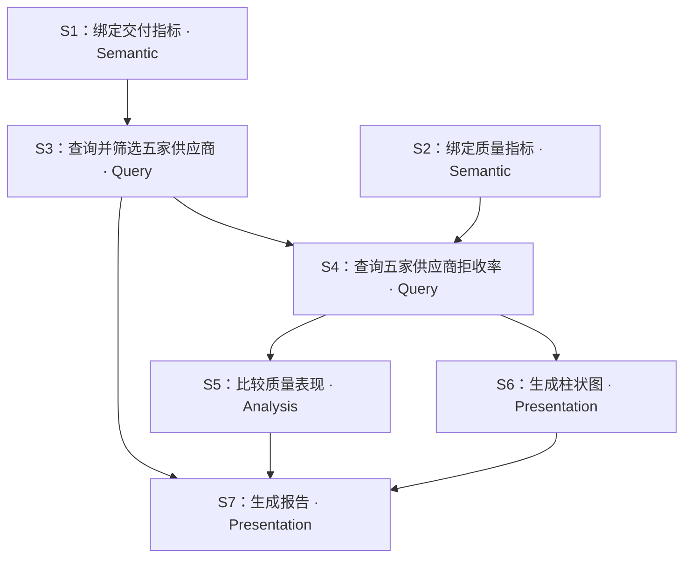

# 企业数据智能问析 Agent 系统：Agent 架构、职责、协作与工具设计

> **文档性质**：架构讨论稿（首版设计），不是已实现功能清单。  
> **设计前提**：沿用已确定的五阶段 Context 装配机制及四层存储架构（Session Log、Task Store、Artifact Store、Summary Store）。  
> **本次范围**：需要哪些 Agent、各自负责什么、如何通信协作，以及各 Agent 使用哪些专属 / 公共工具。  
> **不在本次确定**：各工具的最终 API 参数、Context 检索与 Token 策略、数据库权限体系细则、Pydantic 全量字段清单。

## 一、总体结论

系统首版采用 **1 个 Unified Supervisor + 4 个专业 Agent**，一共五个逻辑 Agent：

| Agent | 核心职责 | 典型产出 |
|---|---|---|
| **Unified Supervisor** | 完整意图理解、任务识别、规划与动态重规划、需求完成检查、最终回答组织 | Intent IR、Task/Revision、Subtask DAG、调度决策与回答 |
| **Semantic Agent** | 业务概念、指标、维度、时间、粒度、合法关系的语义绑定与歧义识别 | 轻量结构化语义绑定结果 |
| **Query Agent** | 根据已绑定语义编制、校验、执行只读查询，处理结果 | `query_result` Artifact |
| **Analysis Agent** | 统计比较、趋势和异常分析、解释已有证据、提出进一步分析建议 | `analysis_result` Artifact |
| **Presentation Agent** | 根据数据与分析结果生成图表、报告 | `chart` / `report` Artifact |

**物理与逻辑划分：** Intent Parsing 与 Supervisor **物理上统一，逻辑上隔离**；同一个大模型服务可以承载多个逻辑 Agent，但应区分角色指令、工具权限和输出约束。首版不单设 Intent Agent、Planner Agent、Replanner Agent、Answer Agent、Chart Agent、Report Agent。

**非 Agent 的基础服务：** Scheduler、Context Manager、Session / Task / Artifact / Summary Service、Semantic Registry、SQL 安全校验器、数据计算引擎等应是确定性服务或工具，不必都包装成 LLM Agent。

## 二、整体架构及通信路径



> 图示为**控制关系与数据流**，不是规定 Semantic → Query → Analysis → Presentation 每次必须串行执行。实际执行由 Supervisor 创建的 DAG 决定，独立节点可并行。Semantic Agent 的短小语义绑定不强制写成一种新 Artifact（见第九节“待明确的接口细节”）。

### 核心通信约定

1. **Supervisor 决策、Scheduler 执行。** Supervisor 输出 Subtask 计划；Scheduler 检查依赖、运行就绪节点、更新状态并回报结果。
2. **Agent 之间原则上不直接互相调用。** 下游 Agent 通过 Subtask 的输入绑定获取上游产物，减少私有消息和隐式状态。
3. **业务结果由 Artifact Store 统一持久化。** Artifact ID 统一采用 `result_001`、`result_002`……，由 `type` 区分 `query_result`、`analysis_result`、`chart`、`report`。
4. **上下文经 Context Manager 按阶段装配。** 不把所有历史和全部查询明细塞入模型；大结果通过 Artifact Tool 选择性读取。
5. **执行事件写 Session Log，任务状态写 Task Store。** 这两者与 Artifact 不互相替代；Summary Store 仅负责历史压缩。

## 三、各 Agent 的职责边界

### 3.1 Unified Supervisor

**负责：**

- **Intent Parsing**：结合 Query 和 Conversation Context 识别本轮完整需求、约束及历史引用；区分新任务、继续、修改与独立问题。
- **规划**：结合当前 Task Revision、已有工作、可用能力生成 Subtask DAG，设置 `depends_on`、逻辑输入和预期输出。
- **Agent 选择**：判断一个 Subtask 应分配给哪个专业 Agent。
- **重规划**：依据中间 Artifact 和执行状态补充或调整后续 Subtask，不机械套用预设流程。
- **结果验收**：检查用户各个 Request 是否被实际满足；可直接组织普通文字回答。

**不负责：**直接承担复杂 SQL 生成、大规模统计计算、渲染图表；也不应代替 Scheduler 手工执行所有节点。

**输入：** 当前 Query、初始 / 规划 / 重规划 Context、当前任务进度、相关 Artifact 摘要。  
**输出：** Intent IR、Task 或 Task Revision 更新提议、Subtask DAG、后续调度 / 结束决策、最终回答。

### 3.2 Semantic Agent

**负责：**

- 将“交付表现”“来料质量”等自然语言概念匹配到已发布的业务指标及实体。
- 明确维度、时间含义、指标粒度和允许的表关联路径。
- 识别歧义、口径冲突、语义注册表缺失，并返回待澄清或无法绑定的情况。

**不负责：**无依据地编造新指标公式；不执行 SQL；不代替 Query Agent 作实际数据提取。

**输入：** 当前业务需求、有关的 Semantic Registry 元数据。  
**输出：** 可供 Query Agent 使用的结构化绑定结果（指标 / 维度 / 时间 / 口径 / 关系等）和必要的歧义说明。

> 对确定性明确的术语匹配，可由 Semantic Service 直接完成，未必每次触发一次 LLM 调用。

### 3.3 Query Agent

**负责：**

- 在语义绑定及授权关系基础上形成查询计划。
- 构建 SQL，并提交确定性校验（只读、允许的表和字段、关联粒度、限制等）。
- 调用受控数据源执行查询；将结果及其基本数据概况持久化为 `query_result`。
- 保留必要的 SQL / 数据源引用，便于追溯和后续复用。

**不负责：**自行改变已确认的业务指标口径；用 LLM 对海量原始记录做人工计算；替代 Analysis Agent 作开放式业务归因。

**输入：** 查询 Subtask、语义绑定、条件及必要上游 Artifact。  
**输出：** `query_result` Artifact 的引用和简短执行摘要。

### 3.4 Analysis Agent

**负责：**

- 对查询结果进行汇总、比较、趋势、异常识别以及基于证据的分析。
- 使用可复核的计算工具处理已有 Artifact，不直接把几十万行数据送入 LLM。
- 将关键发现、结论、必要证据引用及完整分析正文存为 `analysis_result`。
- 在发现值得继续调查的问题时，将建议交给 Supervisor；区分“现有数据支持的事实”与“尚待验证的原因”。

**不负责：**绕过 Supervisor 直接扩展多个新业务领域；未经语义确认直接编造或更改指标计算方式。

**输入：** 分析 Subtask、上游 `query_result` / 已有 `analysis_result`、任务约束。  
**输出：** `analysis_result` Artifact、必要的后续分析建议。

**查询边界：** 如果只是对已有 Artifact 做筛选 / 聚合 / 统计，可使用 Artifact 计算工具；如果需要访问新的底层业务表或新领域，应请求 Supervisor 新增 Query Subtask。

### 3.5 Presentation Agent

**负责：**

- 根据 Query / Analysis 结果和用户的展示要求生成图表配置及渲染产物。
- 生成包含主要发现、图表和证据的报告，并保留来源引用。
- 对图表保存必要的数据映射与实际图例信息，便于解释“蓝线是什么”等问题。

**不负责：**重新定义原始指标口径、偷偷计算未验证的新结论；图表工具不可自动更改数据事实。

**输入：** 图表 / 报告 Subtask、数据 Artifact、分析 Artifact、展示要求。  
**输出：** `chart` 或 `report` Artifact；普通文字总结也可以由 Supervisor 直接输出。

## 四、Agent 各自能使用哪些 Tool

下面列出的工具名是**推荐的逻辑接口名**，不是声明项目中已经存在的实际实现。首版优先使用少量稳定工具，内部可以进一步调用数据服务或文件服务。

| Agent | 工具（示例） | 用途 | 权限边界 |
|---|---|---|---|
| **Unified Supervisor** | `get_task_state`、`get_artifact_overview`、`get_available_capabilities` | 读取任务进度、结果概览与可用能力 | 只读查询；规划 / 状态变更经 Task Service 和 Scheduler |
| **Semantic Agent** | `search_semantic_registry`、`get_metric_definition`、`get_relation_paths` | 检索业务指标、定义和合法关系 | 只读已发布语义配置 |
| **Query Agent** | `get_bound_semantics`、`validate_sql`、`execute_readonly_sql`、`save_artifact` | 使用语义绑定、校验并执行查询、保存结果 | 仅经受控查询网关访问业务数据 |
| **Analysis Agent** | `inspect_artifact`、`read_artifact`、`compute_artifact`、`save_artifact` | 获取已有结果、精确聚合 / 统计、持久化分析 | 原则上仅操作已有 Artifact；不开放原始业务库任意 SQL |
| **Presentation Agent** | `inspect_artifact`、`read_artifact`、`render_chart`、`render_report`、`save_artifact` | 读取结果、生成图表和报告 | 仅生成展示产物，不改变原始查询数据 |

### 4.1 公共 Tool

以下工具可以由多个专业 Agent 复用，但**复用接口不等于每个 Agent 都拥有全部权限**：

| 公共 Tool | 功能 | 适用对象 |
|---|---|---|
| `inspect_artifact(artifact_id)` | 查看类型、摘要、内容概况、数据规模与可用字段 | Supervisor（概览）、Query、Analysis、Presentation |
| `read_artifact(artifact_id, selector)` | 读取完整内容或受限的数据切片 | Query、Analysis、Presentation；Supervisor 原则上仅按需读取摘要和关键证据 |
| `save_artifact(data, metadata)` | 生成并登记新的可复用产物 | Query、Analysis、Presentation，经服务层统一校验 |
| `get_task_state(task_id)` | 获取目标、当前 Revision、Subtask 状态 | Supervisor；专业 Agent 通常只需调度器注入当前 Subtask 信息 |

**不建议作为全员公共工具：**

- `execute_readonly_sql`：仅 Query Agent 可调用；SQL 的安全与权限由确定性执行层检查。
- `compute_artifact`：以 Analysis Agent 为主；如 Query Agent 需要处理已有结果也可受限开放，但不能绕过业务语义口径。
- `render_chart`、`render_report`：由 Presentation Agent 使用。
- `search_semantic_registry` 等：语义绑定由 Semantic Agent 主导，Query Agent 可只读取已确认绑定结果。

### 4.2 Tool、Agent、Service 的边界

| 对象 | 是 Agent 吗？ | 主要职责 |
|---|---|---|
| Scheduler | 否 | 识别就绪 Subtask，组织串行 / 并行，接收执行结果并推进 DAG |
| Context Manager | 否 | 按不同阶段装配输入、引用和必要内容 |
| Semantic Registry | 否 | 管理已发布的指标、维度、表关系及口径 |
| SQL 校验与执行层 | 否 | 确定性安全校验、权限检查、真正运行 SQL |
| Artifact Service / Tool | 否 | 结果定位、摘要查看、选择性读取、计算 / 保存 |
| 四个 Store | 否 | 持久化会话事件、任务、产物、摘要 |

Agent 通过工具访问服务，**不应直接修改其他 Store 的内部记录**。尤其 `save_artifact` 应由 Artifact Service 统一生成 ID、写入内容和元数据，并返回引用。

## 五、Agent 之间的消息如何传递

首版保留三种最重要的逻辑通信对象：

| 对象 | 从哪里来 | 传给谁 | 作用 |
|---|---|---|---|
| **Intent IR** | Supervisor 的 Intent 阶段 | Supervisor 的 Planning 阶段 | 表达本轮真实需求及变更；不是 Subtask |
| **Subtask** | Supervisor 的 Planning 阶段 | Scheduler → 专业 Agent | 描述单个执行目标、依赖关系、输入引用、预期输出 |
| **Execution Result** | 专业 Agent / 执行服务 | Scheduler → Supervisor | 报告执行状态、业务结果引用、必要摘要与后续建议 |

### 5.1 一个简化的执行结果示例

```json
{
  "subtask_id": "subtask_003",
  "status": "completed",
  "summary": "完成五家供应商的来料质量比较",
  "produced_outputs": [
    {
      "name": "analysis",
      "artifact_ref": {"kind": "artifact", "id": "result_003"}
    }
  ],
  "suggestions": ["可以进一步检查异常材料类别"]
}
```

真实分析正文保存到 `result_003` 对应的 Artifact 内容地址，不必复制到 Execution Result 中。

### 5.2 上下游结果引用

- **规划前**：Supervisor 知道上游 Subtask 预计产生什么，但还不知道真实 `result_xxx` ID。
- **执行后**：专业 Agent 创建 Artifact，Scheduler / Task Service 将输出名称映射到真实 Artifact 引用。
- **下游执行前**：Scheduler 解析该引用并调用 Context Manager，为下一专业 Agent 装配所需数据概览及按需读取工具。
- **重规划时**：Supervisor 查看新增结果概览、任务状态与用户未满足需求，决定下一步。

也就是说，**`depends_on` 表示执行先后，`input_bindings` 表示使用哪项上游输出，Artifact 引用表示实际结果在哪里**。三者各有职责。

## 六、一次完整任务如何协作

示例用户 Query：

> 查询 2025 年上半年交付准时率最低的五家供应商，分析这五家的来料拒收率，生成柱状图并输出报告。

Supervisor 可能规划如下 DAG（仅示意，不是固定工作流）：



此 DAG 体现：

1. **并行**：S1、S2 可以同时绑定不同指标；S5、S6 在读取到同一查询结果后可以并行。
2. **串行依赖**：S4 必须获得 S3 选中的供应商集合，否则无法限定分析对象。
3. **产物复用**：S3 产生的 `result_001`、S4 产生的 `result_002` 可以供多个下游 Subtask 引用，无需重复查询。
4. **动态重规划**：S5 若发现需要进一步核查的异常，提交建议给 Supervisor；Supervisor 再判断是否追加新的查询或分析节点。
5. **需求验收**：Supervisor 最终核查供应商排名、质量分析、图表、报告是否全部满足，而非只检查最后一个 Subtask 是否结束。

## 七、与四个 Store 的对应关系

| Store | 记录什么 | 与 Agent 的关系 |
|---|---|---|
| **Session Log** | 用户 Query、Intent Event、关键 Agent / Tool 执行事件、最终回答 | 保存过程和可见回答；一般不存完整业务结果 |
| **Task Store** | Task、Task Revision、Subtask DAG、执行状态和输出绑定 | Supervisor 规划，Scheduler 更新；专业 Agent 使用当前 Subtask 的必要视图 |
| **Artifact Store** | 业务产物元数据、完整内容地址、源产物引用 | Query / Analysis / Presentation 的主要输出位置；后续 Agent 复用 |
| **Summary Store** | 压缩后的对话历史与关键引用 | 长对话辅助理解；不是当前 Task 状态或数据事实的权威来源 |

延续此前约定：

**Artifact Store = Metadata + Content Reference + Full Content**  
**Context Manager = Select Metadata + Expose Read Tools + Load Required Content**

Analysis Result 也具有 `content_ref`，用来保存完整分析正文；其 `summary` 用来快速理解结果，`source_refs` 用来追溯实际依据。

## 八、首版不建议增加的 Agent

| 候选 | 首版处理方式 |
|---|---|
| Intent Agent、Planner Agent、Replanner Agent | 全部是 Unified Supervisor 内部的逻辑阶段 |
| Memory Agent | 由 Session / Summary 服务负责存储及压缩 |
| Context Agent | Context Manager 作为基础服务 |
| SQL Validation Agent | 确定性 SQL 安全校验器 |
| Chart Agent、Report Agent | Presentation Agent 的不同能力 |
| Answer Agent | 简单文本回答由 Supervisor 组织；复杂报告交给 Presentation Agent |

原则：**尽可能通过明确的 Subtask、工具与服务复用实现功能，避免为每项功能都增加一层 Agent。**

## 九、目前仍需明确的少量接口问题

这部分不影响五个 Agent 的总体分工，但在落地时需要补充：

1. **Semantic Agent 轻量输出如何持久化？** 既定 Artifact 类型暂时只有 `query_result`、`analysis_result`、`chart`、`report`。因此不应把语义绑定强行伪装为 `query_result`。首版可以让语义绑定通过受控的 Subtask 执行结果交给后续 Query Agent，并由 Task Service 保存足够的任务输入记录；若未来确需跨任务复用，再讨论是否新增专门的 Artifact 类型。
2. **工具的最终名字、参数与权限矩阵** 尚未定稿。本文为逻辑接口清单，可以直接作为设计依据，不等于代码已存在。
3. **Analysis Agent 的探索范围**：已有 Artifact 内部的数据筛选与统计由其自主完成；跨新的业务表或新领域数据查询由 Supervisor 决策后交给 Query Agent。
4. **专业 Agent 的输出结构应保持精简**：结果摘要、状态、Artifact 引用为主要内容，建议和附加参数按需提供；不要求产生复杂的 Finding / Hypothesis ID 网络。

---

## 十、最终设计原则

- **统一决策中心**：Supervisor 负责意图、规划、重规划和完成检查。
- **明确执行边界**：四个专业 Agent 各自完成语义绑定、查询、分析、展示工作。
- **集中调度**：Scheduler 依据 DAG 调度，不由专业 Agent 互相调用。
- **共享工具、受限授权**：Artifact 检索读取可公用；SQL 执行和渲染工具按职责限制。
- **轻量通信**：Subtask 和 Execution Result 只传必要目标、状态、摘要与引用；完整业务产物留在 Artifact Store。
- **保留动态性**：分析结果反馈给 Supervisor，按用户目标判断是否继续生成新的 Subtask。

**一句话概括：Supervisor 决定做什么，Scheduler 决定何时运行，专业 Agent 负责具体执行，Artifact Store 负责结果保存与复用，Context Manager 负责提供所需输入。**
