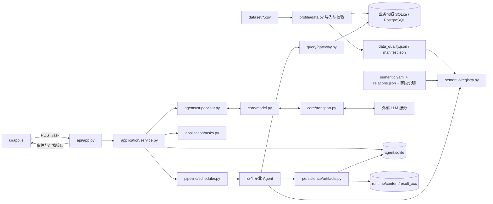
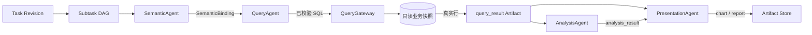

# 代码职责与数据流

本文按当前 `src/enterprise_agent/` 实现编写。先看系统怎样处理一次提问，再按文件查职责。`query.md`、`Agent.md`、`memory.md`、`context.md` 是设计依据；运行时以这里列出的代码和数据为准。

## 1. 一眼看懂整体结构



**三条边界：**外部 LLM 决定意图、计划、工具调用和回答，但不能直接连接业务库；`QueryAgent` 通过只读查询网关取数；大结果写入 Artifact 文件，事件和回答只保存引用。用户账号、认证令牌、审计另存在 `application.sqlite`。

## 2. 核心数据对象

| 对象 | 含义与移动方式 |
| --- | --- |
| `Session` | 一个聊天会话，属于一个用户；包含最近活动 Task 和最近回答 Event 的提示 ID。 |
| `SessionEvent` | 按 `seq` 排序的会话事件。保存用户原话、意图、Agent 摘要、工具调用摘要、回答 Blocks；不保存大表正文。 |
| `Turn` | 一次用户提问及其处理过程，用 `turn_id` 关联同轮事件。 |
| `Intent` | Supervisor 对本轮话语的解释：新建、继续、修改、独立问答或澄清，及需求变化和引用。 |
| `Task` / `TaskRevision` | 业务任务及完整需求版本。修改会产生新 Revision，旧需求版本保留。 |
| `Subtask` | 计划中的一个工作节点；`depends_on` 定顺序，`input_bindings` 指向真实输入，`produced_outputs` 记录命名输出。 |
| `SemanticBinding` | Semantic Agent 确认的表、字段、已发布指标、关系、粒度和时间口径；是轻量执行结果，不是数据表。 |
| `Artifact` | `query_result`、`analysis_result`、`chart` 或 `report` 的元数据；有 `result_xxx` ID、来源引用和 `content_ref`。正文在 `runtime/content/`。 |
| `AnswerBlock` | 用户最终看到的有序文本、表格、图表、报告块；展示块通过 Artifact 引用取内容。 |
| `SessionSummary` | 较早事件的累积摘要，仅用于上下文；精确数值仍从 Artifact 读取。 |

这些字段的严格结构由 [`core/models.py`](../src/enterprise_agent/core/models.py) 和 [`intent/models.py`](../src/enterprise_agent/intent/models.py) 定义。模型输出、存储写入都会经过结构校验。

## 3. 各代码文件做什么

### 启动、接口与网页

| 文件 | 主要职责 |
| --- | --- |
| [`start-local.ps1`](../start-local.ps1) | 建立虚拟环境、安装项目、运行初始化，再以本机 `8000` 端口启动服务。 |
| [`application/bootstrap.py`](../src/enterprise_agent/application/bootstrap.py) | 检查 CSV 快照是否变化；需要时导入数据，并初始化管理员及 Agent Store；不调用 LLM。 |
| [`api/app.py`](../src/enterprise_agent/api/app.py) | FastAPI 路由：静态页面、认证、问析、会话/任务/产物读取、审计和用户管理。`/ask` 转给 `Application.ask()`。 |
| [`api/identity.py`](../src/enterprise_agent/api/identity.py) | 账号、密码哈希、Bearer 令牌、角色权限、审计及反馈；使用独立的 `application.sqlite`。 |
| [`ui/index.html`](../src/enterprise_agent/ui/index.html) | 登录页、总览、聊天、目录、执行记录、管理页面及产物详情抽屉的 HTML 结构。 |
| [`ui/app.js`](../src/enterprise_agent/ui/app.js) | 调接口、保存当前标签页的令牌和会话 ID、渲染历史回答 Blocks、按需获取产物、画 SVG 图表、处理提问和交互。 |
| [`ui/app.css`](../src/enterprise_agent/ui/app.css) | 全站基础布局与通用组件样式。 |
| [`ui/chat.css`](../src/enterprise_agent/ui/chat.css) | 聊天、产物卡片、详情抽屉、响应式布局及黑白灰主题覆盖。 |

### 问析编排与需求版本

| 文件 | 主要职责 |
| --- | --- |
| [`application/service.py`](../src/enterprise_agent/application/service.py) | 总入口 `Application`：组装依赖、串联 Intent→Revision→Plan→执行→验收→回答，控制暂停/恢复，并校验最终引用。 |
| [`application/tasks.py`](../src/enterprise_agent/application/tasks.py) | 把本轮需求变化合并为完整 Revision；校验引用、依赖图和计划；解析 Subtask 的逻辑输入为实际 Artifact 或语义绑定。 |
| [`intent/models.py`](../src/enterprise_agent/intent/models.py) | `Intent`、`RequestChange` 的结构与字段校验。 |
| [`pipeline/scheduler.py`](../src/enterprise_agent/pipeline/scheduler.py) | 查找依赖已满足的节点，按波次并行执行；记录成功、失败、跳过和暂停状态；需要时把新结果交回 Supervisor 重规划。 |
| [`context/manager.py`](../src/enterprise_agent/context/manager.py) | 为初始理解、规划、单节点执行、重规划、最终回答分别组装上下文；小查询结果可随上下文给出，大结果只给元数据和读取入口。 |

### Agent、Prompt、工具与模型

| 文件 | 主要职责 |
| --- | --- |
| [`agents/prompt.py`](../src/enterprise_agent/agents/prompt.py) | 集中保存 Supervisor 四阶段和四个专业 Agent 的角色指令。 |
| [`agents/capabilities.py`](../src/enterprise_agent/agents/capabilities.py) | 五个逻辑角色的能力说明，供规划和工具发现使用。 |
| [`agents/base.py`](../src/enterprise_agent/agents/base.py) | 共享调用契约；`ArtifactAgent` 负责工具装配、核对命名输出及产物类型，减少专业 Agent 重复代码。 |
| [`agents/supervisor.py`](../src/enterprise_agent/agents/supervisor.py) | 同一个 Supervisor 的 Intent、Planning、Completion、Answer 四个逻辑阶段；不直接执行业务 SQL。 |
| [`agents/specialists.py`](../src/enterprise_agent/agents/specialists.py) | `SemanticAgent`、`QueryAgent`、`AnalysisAgent`、`PresentationAgent` 及角色分发表。 |
| [`agents/tools.py`](../src/enterprise_agent/agents/tools.py) | 按角色注册工具，并限定专业 Agent 只能读取当前输入及来源链。Semantic 查目录，Query 查业务库，Analysis 算已有产物，Presentation 生成图表/报告。 |
| [`core/model.py`](../src/enterprise_agent/core/model.py) | 与供应商无关的模型工具循环：构造系统指令及 JSON Schema、发送上下文、执行授权工具、校验结构化输出。 |
| [`core/transport.py`](../src/enterprise_agent/core/transport.py) | `ChatTransport` 接口与 OpenAI 兼容 Chat Completions HTTP 适配器；实际网络请求只在这里。 |
| [`core/config.py`](../src/enterprise_agent/core/config.py) | 项目/运行目录、模型地址与密钥读取、节点数/并行数/工具轮次/上下文长度等预算。 |
| [`core/models.py`](../src/enterprise_agent/core/models.py) | Agent 通信、计划、证据、回答以及持久化记录的 Pydantic 严格结构。 |

**四个专业 Agent 的产出：**Semantic 产生 `SemanticBinding`；Query 产生 `query_result`；Analysis 产生 `analysis_result`（也可通过工具创建中间查询结果）；Presentation 产生 `chart` 或 Markdown `report`。专业 Agent 之间通过 Subtask 输入和 Artifact 引用传递数据，不互相直接调用。

### 语义、SQL 与数据准备

| 文件 | 主要职责 |
| --- | --- |
| [`semantic/registry.py`](../src/enterprise_agent/semantic/registry.py) | 汇合真实表字段、字段中文含义、登记关系和语义目录；区分已发布与候选指标，校验语义绑定。 |
| [`query/validation.py`](../src/enterprise_agent/query/validation.py) | 用 SQL AST 解析并限制单条只读 SELECT，核对授权表/字段、函数与登记 JOIN；防止父表聚合被明细关联重复计数。 |
| [`query/gateway.py`](../src/enterprise_agent/query/gateway.py) | 只读业务库入口：先调用 SQL 校验，再执行 SQLite 或 PostgreSQL 查询，并施加时间、行数及 PostgreSQL 计划预算。 |
| [`profile/data.py`](../src/enterprise_agent/profile/data.py) | 扫描 CSV、推断字段类型、检查主键与日期，导入 SQLite 快照；生成质量报告、快照清单和 `schema.sql`。 |
| [`profile/db_profile.py`](../src/enterprise_agent/profile/db_profile.py) | 对实际数据库做表、列、空值、取值和关系画像，输出诊断用 `db_profile.json`。 |
| [`profile/postgres_import.py`](../src/enterprise_agent/profile/postgres_import.py) | 在空 PostgreSQL 库中事务式导入 CSV，建立业务表、关系及 `analysis` 视图。 |
| [`profile/provision_readonly.py`](../src/enterprise_agent/profile/provision_readonly.py) | 给 PostgreSQL 只读账号授予 `analysis` 视图读取权限。 |
| [`profile/upgrade_analysis_views.py`](../src/enterprise_agent/profile/upgrade_analysis_views.py) | 在已有 PostgreSQL 环境补齐或更新 `analysis` 视图列。 |
| [`config/relations.json`](../config/relations.json) | 允许的业务表关联关系，供语义绑定和 SQL 校验使用。 |
| [`semantic.yaml`](../semantic.yaml) | 当前语义目录；其中 `candidate` 指标尚未发布，不能当作已批准公式。 |
| [`docs/电子供应链数据表说明.md`](电子供应链数据表说明.md) | 字段的业务说明，Registry 用它补充字段含义。 |

### 存储与验证

| 文件 | 主要职责 |
| --- | --- |
| [`persistence/stores.py`](../src/enterprise_agent/persistence/stores.py) | 管理 `agent.sqlite` 中的 Session、Event、Task、Revision、Subtask、Artifact、Summary 记录，生成全局 ID，并检查会话归属。 |
| [`persistence/artifacts.py`](../src/enterprise_agent/persistence/artifacts.py) | 将完整产物写入 `runtime/content/result_xxx/`；按页读取数据、读取 SQL；在隔离内存 SQLite 中对已有查询产物做精确计算。 |
| [`persistence/summaries.py`](../src/enterprise_agent/persistence/summaries.py) | 当旧事件达到阈值时追加累积摘要；不删除原事件，也不把摘要当作精确数据。 |
| [`evaluation/smoke.py`](../src/enterprise_agent/evaluation/smoke.py) | 使用临时存储和可注入的模型夹具验证 DAG、跨轮修改、工具、SQL 安全、HTTP 等主流程。 |
| [`evaluate.py`](../evaluate.py) | 验收脚本入口；`--live` 额外调用真实模型。 |

各包的 `__init__.py` 主要用来标识 Python 包；业务入口在上表所列模块。`Dockerfile`、`compose.yaml`、`pyproject.toml`、`requirements.txt` 分别负责镜像、容器编排、Python 包定义和依赖；`.env.example` 列出部署所需配置名，实际密钥不应写进本文。

## 4. 数据怎样移动

### A. 启动前：CSV 到业务快照

1. [`profile/data.py`](../src/enterprise_agent/profile/data.py) 从 `dataset/*.csv` 读取业务数据，检查重复主键和日期格式，计算源文件哈希。
2. 默认本地模式把数据导入 `runtime/supply_chain.sqlite`，并写 `runtime/data_quality.json`、`runtime/manifest.json`；`snapshot_id` 由源文件哈希生成。PostgreSQL 部署则由 `profile/postgres_import.py` 导入并通过 `analysis` 视图供只读查询。
3. [`semantic/registry.py`](../src/enterprise_agent/semantic/registry.py) 读取质量报告、`semantic.yaml`、`config/relations.json` 和字段说明，形成 Agent 可用的元数据。目录描述“有什么、含义是什么”，并非查询结果。

### B. 一次提问：浏览器到计划

1. [`ui/app.js`](../src/enterprise_agent/ui/app.js) 从输入框读取问题及可选日期条件，带当前 `session_id` 调用 `POST /ask`。认证令牌存于当前浏览器标签页的 `sessionStorage`，请求使用 Bearer 头。
2. [`api/app.py`](../src/enterprise_agent/api/app.py) 检查登录和角色，再调用 `Application.ask()`，并把本次状态写入认证库的审计表。
3. `Application` 创建或核对 Session，生成 `turn_id`，把原话写为 `user_message` 事件。
4. Supervisor 使用 `ContextManager.initial()` 的最近消息、候选任务/产物和摘要，输出 `Intent`。独立知识问答可直接回答；需要澄清则返回澄清；业务任务进入下一步。
5. [`application/tasks.py`](../src/enterprise_agent/application/tasks.py) 将 Intent 变成完整 Task Revision。Supervisor 再根据 Revision 和能力说明输出动态 Subtask DAG；代码检查节点 ID、需求归属、依赖和输入绑定后才保存。

### C. 执行：语义、查询、分析、展示



这张图是常见的含数据查询路径，**不是固定执行顺序**。Scheduler 以实际 DAG 为准：就绪且独立的节点可并行；节点要求重规划或提出建议时，再由 Supervisor 判断下一步。

- Semantic Agent 查目录并返回已确认的表、字段和口径。`QueryAgent` 没有确认的语义输入就不能查询。
- Query Agent 通过 `QueryGateway` 验证并执行只读 SQL。数据库返回的真实行交给 `Artifacts.save()`，完整 `data.json` 落盘，SQL 写 `query.sql`，Artifact 元数据写 `agent.sqlite`。
- Analysis Agent 可分页读 Artifact；需要全量精确计算时，`Artifacts.compute()` 只把授权的 `query_result` 装入**内存 SQLite** 执行 SELECT，不重新连接业务库。分析正文保存为 `analysis.md`。
- Presentation Agent 读取真实查询结果，保存含数据、轴映射、系列名和来源的 `chart.json`，或保存 `report.md`。它不在页面上临时编造数据。
- 工具返回给模型的通常是概览和受限切片；完整内容留在 Artifact Store。模型调用的网络传输由 `core/transport.py` 负责，Agent 只通过 `ModelRunner` 接口调用。

### D. 验收和返回页面

1. Supervisor 对 Revision 的每一项需求给出完成状态和证据引用；`Application.validate_completion()` 检查引用确实属于当前需求的有效执行结果。
2. Supervisor 生成有序 `AnswerBlock`；`Application.respond()` 分配 `block_id`，核对表格/图表/报告 Block 的 Artifact 类型，并保存为 `assistant_response` 事件。
3. `POST /ask` 返回状态及引用。网页随后读取 `GET /sessions/{id}/events` 重建聊天消息；遇到 Artifact 引用，再请求 `/artifacts/{id}` 和 `/artifacts/{id}/content`。
4. 表格先取少量预览行，打开详情后分页取数；图表由 `ui/app.js` 读取已存配置绘制 SVG；“查看图表数据”打开其来源查询产物；SQL 与语义口径由 `/artifacts/{id}/sql` 按需读取。

### E. 追问、修改与摘要

追问会沿用同一个 Session，但继续或修改哪个 Task 必须由 Intent 明确给出 `target_task_id`。修改生成新 Revision；受影响的 Subtask 及其后继标为 `superseded`，仍适用的已完成产物可复用，旧回答和旧产物不被覆盖。较长会话可生成 `SessionSummary` 减少上下文体积；要核对历史数字时仍从 Event/Artifact 读取。

### F. 一个具体例子

用户问“列出前 5 个产品并画条形图”时，可能出现下面的路径（`result_001` 等 ID 仅作说明，实际 ID 由 Store 分配）：

```text
输入框问题
  → POST /ask → user_message Event
  → Intent 增加“取产品数据”和“画图”需求 → TaskRevision
  → SemanticAgent 绑定 Products.product_id / product_name
  → QueryAgent 提交只读 SELECT → QueryGateway → 业务快照
  → runtime/content/result_001/data.json + query.sql
  → PresentationAgent 读取 result_001 → result_002/chart.json
  → assistant_response.blocks 引用 result_002
  → 页面 GET /sessions/{id}/events → GET /artifacts/result_002/content
  → 聊天中显示图；点击“查看图表数据”再读取 result_001
```

这样可以从图表的 `source_refs` 找到查询产物，从查询产物找到 SQL、语义绑定和数据快照。图表渲染使用已保存的真实行；当前黑白主题只改变页面上的绘图颜色，不改变源数据。

## 5. 数据分别存在哪里

| 位置 | 保存内容 | 是否是真实数值来源 |
| --- | --- | --- |
| `dataset/*.csv` | 原始业务输入文件 | 是，初始化源。 |
| `runtime/supply_chain.sqlite` 或 PostgreSQL `analysis` 视图 | 可查询的业务快照 | 是，业务查询源。 |
| `runtime/data_quality.json`、`manifest.json` | 字段、行数、质量信息和快照 ID | 是元数据，不是查询结果。 |
| `runtime/application.sqlite` | 用户、认证会话、审计、反馈 | 否。 |
| `runtime/agent.sqlite` | 会话事件、任务版本、DAG、产物元数据和摘要 | 保存执行事实和引用，不存大表正文。 |
| `runtime/content/result_xxx/data.json` | 查询产物的完整行 | 是，可复查的查询结果。 |
| `runtime/content/result_xxx/query.sql` | 该结果实际执行的 SQL | 查询依据。 |
| `runtime/content/result_xxx/analysis.md`、`chart.json`、`report.md` | 分析、图表配置、报告正文 | 派生产物，须沿 `source_refs` 追溯。 |

`content_ref` 是形如 `storage://artifacts/result_xxx/data.json` 的受管引用，**不是浏览器可以直接访问的 URL**。浏览器只能经鉴权的 Artifact API 读取。`runtime/` 中也可能存在旧版遗留文件；当前主流程所用位置以上述代码为准。

## 6. 排查一条问题时从哪里开始

1. 看浏览器发送的 `POST /ask` 参数，以及 [`api/app.py`](../src/enterprise_agent/api/app.py) 的 `execute_question()`。
2. 用返回的 `session_id` 查 `/sessions/{id}/events`，按 `seq` 看原话、Intent、工具与最终 Blocks。
3. 用 `task_id` 看 `/tasks/{id}`，核对 Revision、节点依赖、输入绑定和状态。
4. 用 `result_xxx` 查 `/artifacts/{id}`，再按类型读取 `/content` 或 `/sql`；根据 `source_refs` 逐级回到源数据。
5. 若问题出在 SQL，检查 `semantic/registry.py` 的绑定、`query/validation.py` 的拒绝原因和 `query/gateway.py` 的只读执行路径；若问题出在页面，检查 `ui/app.js` 的 Block/Artifact 渲染。

设计要求与实现的逐项对应另见 [`ARCHITECTURE.md`](ARCHITECTURE.md)。
