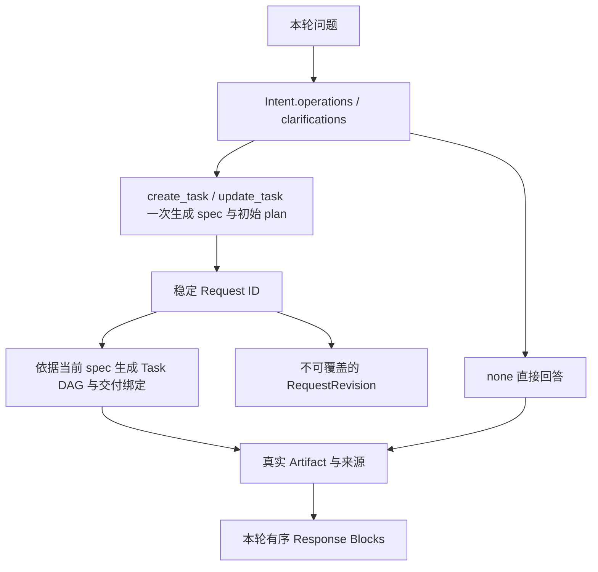

# 第三版字段与数据流

本版采用持久 Request、完整 RequestRevision、执行 Task、Artifact。原业务 Task 的职责归入 Request，原 Subtask 改为执行 Task。模型字段以 src/enterprise_agent/core/models.py 和 intent/models.py 为准。

## 1. 对象关系



同一轮可以处理多个 Request。Request 间通过引用表达输入依赖，代码按依赖顺序处理。每个 Request 内的独立就绪 Task 可以并行。当前服务采用一个 Uvicorn worker，单个会话串行处理用户轮次。

## 2. Intent

顶层字段为 operations 和 clarifications。每项操作包含下列字段。

| 字段 | 含义与规则 |
| --- | --- |
| request_id | none/create_task 使用本轮局部名称，代码转换为全局 req_xxx。update_task 必须使用已存在的真实 ID |
| action | none 直接回答，create_task 创建需执行的新工作，update_task 修改已有工作 |
| category | general_qa、business_knowledge 固定使用 none。data_analysis、result_interaction 使用 create_task 或 update_task |
| instruction | 本轮完整指令，update_task 描述具体修改 |
| refs | 本轮理解和定位所需的对象引用 |

Request ID 是持久业务身份。下一轮修改同一项工作时继续使用它。none 请求也会保留记录和回答来源，其执行 Task 可以为空。

clarifications 的字段为 request_id、subject、question、refs。目标尚不明确时 request_id 可为空。明确的其他操作仍可完成。

```json
{
  "operations": [
    {
      "request_id": "new_mean",
      "action": "none",
      "category": "general_qa",
      "instruction": "解释平均值",
      "refs": []
    },
    {
      "request_id": "new_data",
      "action": "create_task",
      "category": "data_analysis",
      "instruction": "统计各产品平均产量",
      "refs": []
    }
  ],
  "clarifications": []
}
```

新名称会在保存意图事件前统一转换，相关 refs 一起转换。代码校验目标归属、重复操作和本轮请求循环依赖。

## 3. Request

| 字段 | 含义 |
| --- | --- |
| request_id | 稳定业务身份 |
| session_id | 所属用户会话 |
| title | 简短展示名称 |
| created_by_turn_id | 首次创建轮次 |
| current_revision_id | 当前完整要求的版本 |
| plan_version | 当前工作累计的执行计划版本 |
| status | pending、running、needs_clarification、completed、failed；archived 用于迁移的已移除历史需求 |
| spec | 当前完整 RequestSpec，由读取模块加载当前版本后组装 |
| created_at / updated_at | 系统维护时间 |

Request 读取对象直接包含 spec，规划、依赖检查和执行入口可以取得完整要求。数据库 requests 记录身份和状态，RequestRecord 表达这一存储结构。spec 只保存在不可覆盖的版本快照中，读取模块根据 current_revision_id 组装完整 Request，并验证版本归属。实际交付通过 Plan.output_bindings、Task.produced_outputs 解析为 Artifact。完整正文和数据保存于 Artifact。用户更新要求时，新版本与失效节点标记在同一事务中保存，比较当前版本以防覆盖并发更新。

## 4. RequestRevision 与完整要求

| 字段 | 含义 |
| --- | --- |
| revision_id | 快照 ID |
| request_id | 所属业务身份 |
| parent_revision_id | 上一版，初版为空 |
| source_intent_event_id | 引起版本变化的 Intent 事件 |
| spec | 完整 RequestSpec |
| created_at | 创建时间 |

RequestSpec 的字段为 description、parameters、inputs、outputs。

- description 保存当前完整业务要求。
- parameters 是每个 Request 独立的参数对象，具体约束语法仍待单独设计。界面显式提交的日期等参数写入本轮对应请求，null 清除对应参数。
- inputs 使用 slot/source 结构保存明确输入。
- outputs 每项包含 name、content_type、description、options。name 在此请求内唯一并保持稳定，content_type 为 text/table/chart/report。

```json
{
  "description": "统计2025年各产品平均产量",
  "parameters": {},
  "inputs": [
    {
      "slot": "previous_data",
      "source": {"kind": "artifact", "id": "result_001"}
    }
  ],
  "outputs": [
    {
      "name": "production_table",
      "content_type": "table",
      "description": "各产品平均产量",
      "options": {}
    }
  ]
}
```

本轮先按 Request 依赖顺序调用 Supervisor.Preparation，每项 create_task/update_task 一次返回完整 spec 和初始 plan。模型同时获得本轮 operation、previous_revision、existing_tasks、deliveries、引用资源、上游候选规格、界面参数与企业目录。未修改的内容应继承，输出名称保持稳定。相同 spec 可以继续使用当前版本。

RequestPreparation 是临时返回对象，定义在 intent/models.py。

| 字段 | 内容 |
| --- | --- |
| spec | 完整 RequestSpec，可为空 |
| plan | 初始 Plan，可为空 |
| clarifications | 复用 Clarification 列表 |

正常结果同时包含 spec 和 plan，clarifications 为空。需要确认完整要求时，只返回 clarifications。代码保留既有工作，并发布澄清文字 Artifact。

none 由代码直接组装文字交付规格，随后调用回答阶段。

代码校验完整需求的输入、命名输出和 Request 依赖图，再投影新规格导致的旧节点失效，校验 Task DAG、真实来源和交付绑定。校验失败时提供候选结果及原因，允许一次重新准备。独立且有效的其他请求可以继续处理。

每个 Request 的新 Revision、失效标记、初始 Task 和两类事件在同一事务中保存。保存前核对准备开始时的 current_revision_id 和 plan_version。未通过校验或事务失败时，既有版本及节点状态继续保留。

快照、Artifact 元数据和历史事件不可覆盖。新交付通过新产物保存。

## 5. 执行 Task

| 字段 | 含义 |
| --- | --- |
| task_id | 系统生成的执行节点身份 |
| request_id / revision_id | 所服务的工作和要求版本 |
| plan_version / created_by_turn_id | 创建于哪个计划、哪一轮 |
| objective | 具体执行目标 |
| assigned_agent | SemanticAgent、QueryAgent、AnalysisAgent、PresentationAgent |
| depends_on | 显式前置执行节点 |
| input_bindings | slot/source 输入绑定 |
| expected_outputs | 本步声明的 Artifact 输出名称 |
| produced_outputs | 执行后真实生成的命名结果 |
| params | 执行配置 |
| replan_after | 完成后是否交回 Supervisor 决定后续工作 |
| semantic_binding | SemanticAgent 的轻量结果 |
| summary / suggestions | 执行摘要及供 Supervisor 判断的建议 |
| status | pending、running、completed、failed、needs_clarification、skipped、cancelled、superseded |
| created_at / started_at / completed_at | 系统维护时间 |

SemanticAgent 不声明 Artifact 输出，绑定通过 task 引用的 semantic_binding 传递。QueryAgent 访问只读业务库。AnalysisAgent 可输出分析正文或精确计算得到的 table Artifact。PresentationAgent 制作表格、图表和报告。

服务默认单 worker。启动时会把上次退出时仍在 running 的节点标记为中断失败，对应 Request 回到待处理状态，以便重新规划。

## 6. Plan 与交付绑定

Plan 字段为 tasks、cancel_task_ids、output_bindings、reason。

tasks 只包含新增节点。模型使用局部 Task ID，代码分配全局 ID 并同时转换依赖及引用。output_bindings 将 RequestSpec.outputs 的 name 指向执行节点的命名输出，或已存在且适用的产物。

```json
{
  "tasks": [],
  "cancel_task_ids": [],
  "output_bindings": {
    "production_table": {"kind": "task", "id": "task_002", "output": "dataset"}
  },
  "reason": "使用实际查询结果交付表格"
}
```

交付读取统一使用 Requests.outputs/resolve，按当前版本的计划绑定查找已完成的执行输出。新版本可以继承规格未变且执行仍然有效的交付绑定。直接回答先保存 text Artifact，再通过计划事件绑定到该产物，供后续输入引用。初始规划与完整 spec 同次生成。后续重规划仅返回 Plan，沿用当前 Revision。代码校验 DAG、节点预算、输入权限、输出名称、失效结果和交付类型。被拒绝的计划及理由会记入账本，并交给 Supervisor 修正。

## 7. 引用、输入和依赖

IntentRef 用于 Intent.refs，包含 kind、id、output。

| kind | 用途 |
| --- | --- |
| artifact | id 指向已有的文字、表格、图表或报告，output 为空 |
| request | id 指向已有或本轮上游 Request，output 必填，表示其命名交付 |

用户指向历史回答时，通过该 ResponseBlock.artifact_id 定位文字或结构化结果。引用固定 Artifact 可复用当时的内容。引用 Request 命名输出会跟随当前有效交付。

执行层使用 ResourceRef，额外支持 task，用于 DAG 内的命名结果和 semantic_binding。event/block_id 保留历史读取兼容。新 Request.spec.inputs 采用 request/artifact。事件仍可通过历史工具读取，返回的回答块可以提供真实 Artifact ID。

Intent.refs 保存已确认的引用身份。Preparation 沿用这些来源，spec.inputs 保存业务输入。新增来源通过工具确认，代码校验明确引用是否遗漏。Task.input_bindings 将外部输入与中间结果交给具体执行 Agent。Artifact.source_artifact_ids 保存实际来源。

本轮后续请求可以引用上游 Request 的逻辑输出。计划保存时校验上游命名交付的声明，保留 request/output 逻辑引用。执行按 Request 依赖排序，上游完成后，调度器将逻辑引用落实为具体 Artifact，保存到消费 Task 的输入绑定中。上游尚未交付时节点保持待执行，并给出缺口说明。

一个 Task 已经通过 context.spec 获得当前要求。DAG 内的未来结果使用上游 Task 的命名输出引用。复用自己的历史数据时，选择真实 Artifact ID。

## 8. Artifact 与溯源

| 字段 | 含义 |
| --- | --- |
| artifact_id | 全局 result_xxx，统一使用无类型前缀的编号 |
| content_type | text、table、chart、report |
| session_id | 产物归属会话，也是访问权限边界 |
| created_by_turn_id | 实际生成轮次 |
| request_id / revision_id / task_id | 生产者所属需求、版本、执行节点，允许为空 |
| producer | Supervisor、System 或四个专业 Agent |
| title / summary | 标题和轻量概览 |
| source_artifact_ids | 实际来源产物 ID 列表，包含文字来源 |
| content_ref | 受管正文地址 |
| payload | 行列信息、语义绑定、数据快照和 provenance |
| created_at | 创建时间 |

OutputSpec.content_type 和 Artifact.content_type 使用同一组值。普通回复和分析正文保存为 text，SQL 数据和制作的表格保存为 table。图表保存 chart 配置，报告保存 report 正文。

| provenance.method | 来源含义 |
| --- | --- |
| business_sql | 业务数据库只读查询，保存 query.sql、语义绑定、快照和版本 |
| artifact_compute | 对完整已有表格精确计算，保存 compute.sql 和上游来源 |
| table_compose | 按需求制作展示表，保存完整行列和真实来源 |
| analysis | 专业分析正文 |
| presentation | 图表或报告制作 |
| answer | Supervisor 文字回复，记录实际输入快照以检查交付有效性 |
| historical_response | 从历史回答迁移得到的文字 |

完整内容位于 runtime/content/result_xxx。写入新产物时分配新编号，旧内容可继续溯源。文字与报告保存 Markdown，表格保存完整行对象列表，图表保存配置和实际绘制数据。空表保留列信息。

```text
展示表格或图表
  → source_artifact_ids
  → 计算表格或查询表格
  → 实际 SQL、语义口径和业务数据快照
```

## 9. 修改、复用与本轮回答

数据目标、参数或数据输入发生变化时，相关执行及下游结果标记失效。仅添加属于本 Request 的旧图表作为展示修改输入时，可保留适用的数据查询。使用 kind=request 逻辑交付的下游需求会随上游相关输出变化而失效。spec.inputs 中明确指定的 artifact 表达固定历史输入，可在上游更新后继续使用原产物或原回答。

修改展示时复用实际来源，产生新图表。修改统计条件时检查旧数据覆盖范围，可精确计算则复用，否则重新查询。显式历史输入可以继续读取，旧 Artifact 保持原有内容。

完成检查按当前 outputs 逐项验收，completed 需要真实交付绑定和证据。回答块带 request_id，只交付本轮处理的请求。输出配置发生局部变化时，代码从版本差异确定本轮交付名称，避免重复展示未修改报告或图表。

Response 包含按展示顺序排列的 blocks。每个 ResponseBlock 只有以下字段。

| 字段 | 含义 |
| --- | --- |
| block_id | 当前回复内的定位编号，由系统分配 |
| artifact_id | 实际展示内容的唯一标识 |
| request_id | 本次展示服务的 Request，可为空 |
| revision_id | 本次展示对应的要求版本，可为空 |

Artifact 的 request_id/revision_id/task_id 记录生产归属。ResponseBlock 的 request_id/revision_id 记录本次展示归属。复用其他 Request 的旧结果时，这两组归属可以不同。

```json
{
  "schema_version": 2,
  "status": "completed",
  "blocks": [
    {
      "block_id": "block_001",
      "request_id": "req_001",
      "revision_id": "rev_001",
      "artifact_id": "result_001"
    },
    {
      "block_id": "block_002",
      "request_id": "req_001",
      "revision_id": "rev_001",
      "artifact_id": "result_002"
    }
  ]
}
```

相同 assistant_response 事件中的 blocks 组成一条回复。块的顺序决定前端展示顺序。前端读取每个 artifact_id，text 作为正文展示，table/chart/report 作为结果卡片展示，并提供详情和来源入口。

回答阶段模型先返回临时 AnswerDraft，每块包含 content_type、content、refs、可选 request_id/output_name。Responses.materialize 保存文字，核验结构化产物并生成 Response。output_name 只用于将草稿交付绑定到 OutputSpec.name，公开块使用 artifact_id 定位。

同一命名文字输出可以由多个段落组成，系统保存各段落，并形成可整体引用的文字交付。文字明确引用的结构化证据可以加入结果卡片，来源链的其余内容可从详情读取。

none 请求记录 Request 并直接形成 text Artifact，执行 Task 为空。无法定位需求的澄清使用会话所属的 System text Artifact，request_id/revision_id/task_id 可为空。执行失败说明也通过 text Artifact 发布。

## 10. 账本与 HTTP

SQLite 核心表为 sessions、session_events、requests、request_revisions、tasks、artifacts、session_summaries，以及 ID 序列表 sequences。各记录以主键、父级索引和 body JSON 保存。artifacts 同时支持会话索引和 Request 索引，访问权限按 session_id 校验。

| 接口 | 用途 |
| --- | --- |
| POST /ask | 本轮多请求识别与处理 |
| POST /bind | 保存要求和计划，等待执行 |
| GET /requests?session_id=... | 当前用户会话内的工作 |
| GET /requests/{id} | 当前版本、执行与产物 |
| GET /requests/{id}/revisions | 完整历史要求快照 |
| GET /tasks/{id} | 实际执行节点及所属 Request |
| POST /requests/{id}/resume | 兼容界面的执行继续操作 |
| GET /sessions/{id}/events | 有序会话事件 |
| GET /artifacts/{id}/content | 精确分页数据或正文 |
| GET /artifacts/{id}/sql | 实际 SQL、口径及来源类型 |
| GET /artifacts/{id}/download | 文字或报告 Markdown |

POST /ask 和 GET /requests/{id} 的快照响应将实际交付放在顶层 deliveries 中，结构为 request_id 到命名结果引用的映射，读取时计算。requests 数组中的每项 Request 包含 spec。认证账户、认证会话、审计和反馈继续使用独立 application.sqlite。

## 11. 旧数据迁移与 Git 回退

源代码基线为 main 上的 fdde3c2，标签 baseline-before-request-refactor。新代码在 refactor/request-task-model 分支。

首次打开旧 agent.sqlite 时，迁移先通过 SQLite backup 保存 agent.before-request-model.sqlite。随后在事务中转换模型，原表保留为 legacy_*。旧 Request ID、事件 ID 和 Artifact ID 保留，业务 Task 转成 Request，旧 Subtask 转成执行 Task。已移除的历史要求归档。任何迁移错误都会回滚表结构和数据变更。

已有 requests 记录中的 results 或 output_refs 会在启动事务中清理。缺失的历史交付绑定先追加为计划事件，保留原始事件和产物。旧字段冲突或迁移校验失败时事务回滚。迁移保留现有 content 文件和认证库。历史产物和旧查询继续可读取。原业务 Task 的读取接口提供兼容查询，新调用使用 /requests。

统一 Artifact 升级使用账本版本 4。启动时先备份 agent.before-unified-artifacts.sqlite，再在事务中映射历史类型、输出规格和回答块，把旧文字及事件交付引用转换为 Artifact 引用。现有 Artifact ID、SQL 和内容文件保留。新增文字文件在迁移校验失败时清理，重复启动不会再次迁移。

回退前应关闭服务并另存整个当前 runtime。代码可以切回 main 或基线标签。已迁移的账本可从 agent.before-request-model.sqlite 恢复。恢复旧账本后，应将 result ID 序列提升至现有 content 目录的最高编号，或使用与旧账本配套的完整内容目录，避免新产物目录编号冲突。

## 12. 验证入口

```powershell
.\.venv\Scripts\python.exe evaluate.py
.\.venv\Scripts\python.exe evaluate.py --live-only
```

验收覆盖合并准备调用、版本与初始计划原子保存、准备澄清、等待同轮上游、引用一致性、计划版本冲突、统一文字与卡片、无 Request 的澄清、跨 Request 产物复用、制作表格、固定意图路由、局部修改、查询复用、二次加工表格、同轮依赖、跨需求失效、独立参数、访问权限、SQLite 事务、历史文字迁移与迁移失败重试。--live-only 使用临时账本和真实模型检查 Products 总数，并与业务快照核对。诊断文件保存在被 Git 排除的 runtime/request-model-live-verification.json。
