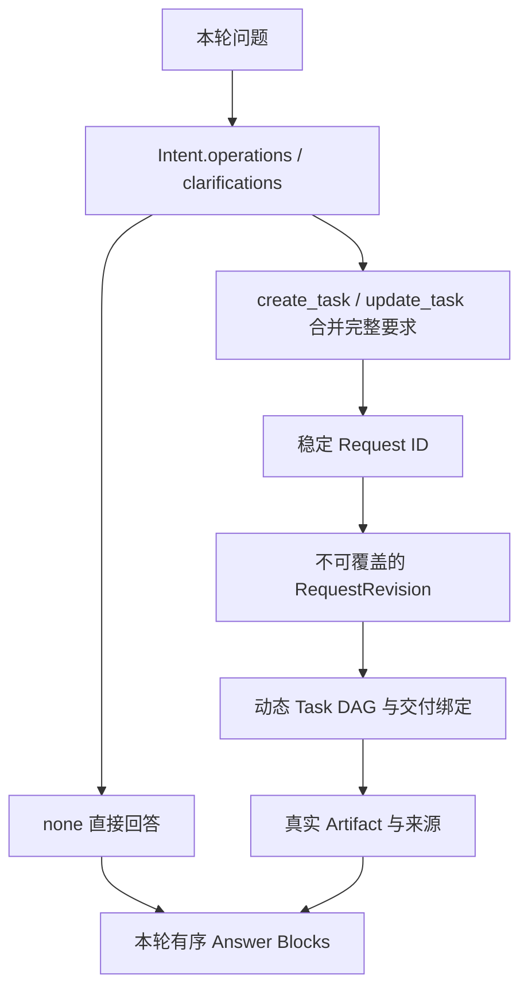

# 第三版字段与数据流

本版采用持久 Request、完整 RequestRevision、执行 Task、Artifact。原业务 Task 的职责归入 Request，原 Subtask 改为执行 Task。模型字段以 src/enterprise_agent/core/models.py 和 intent/models.py 为准。

## 1. 对象关系



同一轮可以处理多个 Request。Request 间通过引用表达输入依赖，代码按依赖顺序处理。每个 Request 内的独立就绪 Task 可以并行。当前服务采用一个 Uvicorn worker，单个会话串行处理用户轮次。

## 2. Intent

顶层字段为 operations 和 clarifications。每项操作包含下列字段。

| 字段 | 含义与规则 |
| --- | --- |
| request_id | none/create_task 使用本轮局部名称，代码转换为全局 req_xxx。update_task 必须使用已存在的真实 ID |
| action | none 直接回答，create_task 创建需执行的新工作，update_task 修改已有工作 |
| category | general_qa、business_knowledge、data_analysis、result_interaction |
| instruction | 本轮完整指令，update_task 描述具体修改 |
| refs | 本轮理解和定位所需的对象引用 |

Request ID 是持久业务身份。下一轮修改同一项工作时继续使用它。none 请求也会保留记录和回答来源，其执行 Task 可以为空。

clarifications 的字段为 request_id、subject、question、refs。目标尚不明确时 request_id 可为空。明确的其他操作仍可完成。

```json
{
  "operations": [
    {
      "request_id": "new_mean",
      "action": "none",
      "category": "general_qa",
      "instruction": "解释平均值",
      "refs": []
    },
    {
      "request_id": "new_data",
      "action": "create_task",
      "category": "data_analysis",
      "instruction": "统计各产品平均产量",
      "refs": []
    }
  ],
  "clarifications": []
}
```

新名称会在保存意图事件前统一转换，相关 refs 一起转换。代码校验目标归属、重复操作和本轮请求循环依赖。

## 3. Request

| 字段 | 含义 |
| --- | --- |
| request_id | 稳定业务身份 |
| session_id | 所属用户会话 |
| title | 简短展示名称 |
| created_by_turn_id | 首次创建轮次 |
| current_revision_id | 当前完整要求的版本 |
| plan_version | 当前工作累计的执行计划版本 |
| status | pending、running、needs_clarification、completed、failed；archived 用于迁移的已移除历史需求 |
| results | 交付名称到真实结果的映射 |
| created_at / updated_at | 系统维护时间 |

Request 输出指向当前有效结果。完整正文和数据继续保存于 Artifact。用户更新要求时，新版本与失效节点标记在同一事务中保存，比较当前版本以防覆盖并发更新。

## 4. RequestRevision 与完整要求

| 字段 | 含义 |
| --- | --- |
| revision_id | 快照 ID |
| request_id | 所属业务身份 |
| parent_revision_id | 上一版，初版为空 |
| source_intent_event_id | 引起版本变化的 Intent 事件 |
| spec | 完整 RequestSpec |
| created_at | 创建时间 |

RequestSpec 的字段为 description、parameters、inputs、outputs。

- description 保存当前完整业务要求。
- parameters 是每个 Request 独立的参数对象，具体约束语法仍待单独设计。界面显式提交的日期等参数写入本轮对应请求，null 清除对应参数。
- inputs 使用 slot/source 结构保存明确输入。
- outputs 每项包含 name、kind、description、options。name 在此请求内唯一并保持稳定，kind 为 text/table/chart/report。

```json
{
  "description": "统计2025年各产品平均产量",
  "parameters": {},
  "inputs": [
    {
      "slot": "previous_data",
      "source": {"kind": "artifact", "id": "result_001"}
    }
  ],
  "outputs": [
    {
      "name": "production_table",
      "kind": "table",
      "description": "各产品平均产量",
      "options": {}
    }
  ]
}
```

Supervisor 的 Definition 阶段读取旧版本和本轮操作，生成完整 spec。未修改的内容应继承。相同 spec 可以继续使用当前版本。输出样式变化保存在对应 output 的 options 或 description，数据目标和参数继续保留。

快照、Artifact 元数据和历史事件不可覆盖。新交付通过新产物保存。

## 5. 执行 Task

| 字段 | 含义 |
| --- | --- |
| task_id | 系统生成的执行节点身份 |
| request_id / revision_id | 所服务的工作和要求版本 |
| plan_version / created_by_turn_id | 创建于哪个计划、哪一轮 |
| objective | 具体执行目标 |
| assigned_agent | SemanticAgent、QueryAgent、AnalysisAgent、PresentationAgent |
| depends_on | 显式前置执行节点 |
| input_bindings | slot/source 输入绑定 |
| expected_outputs | 本步声明的 Artifact 输出名称 |
| produced_outputs | 执行后真实生成的命名结果 |
| params | 执行配置 |
| replan_after | 完成后是否交回 Supervisor 决定后续工作 |
| semantic_binding | SemanticAgent 的轻量结果 |
| summary / suggestions | 执行摘要及供 Supervisor 判断的建议 |
| status | pending、running、completed、failed、needs_clarification、skipped、cancelled、superseded |
| created_at / started_at / completed_at | 系统维护时间 |

SemanticAgent 不声明 Artifact 输出，绑定通过 task 引用的 semantic_binding 传递。QueryAgent 访问只读业务库。AnalysisAgent 可输出分析正文或精确计算得到的 query_result。PresentationAgent 保存图表和报告。

服务默认单 worker。启动时会把上次退出时仍在 running 的节点标记为中断失败，对应 Request 回到待处理状态，以便重新规划。

## 6. Plan 与交付绑定

Plan 字段为 tasks、cancel_task_ids、output_bindings、reason。

tasks 只包含新增节点。模型使用局部 Task ID，代码分配全局 ID 并同时转换依赖及引用。output_bindings 将 RequestSpec.outputs 的 name 指向执行节点的命名输出，或已存在且适用的产物。

```json
{
  "tasks": [],
  "cancel_task_ids": [],
  "output_bindings": {
    "production_table": {"kind": "task", "id": "task_002", "output": "dataset"}
  },
  "reason": "使用实际查询结果交付表格"
}
```

代码校验 DAG、节点预算、输入权限、输出名称、失效结果和交付类型。被拒绝的计划及理由会记入账本，并交给 Supervisor 修正。

## 7. 引用、输入和依赖

ResourceRef 包含 kind、id，以及可选 output、block_id。

| kind | 用途 |
| --- | --- |
| request | 引用业务工作，output 指定其交付名称 |
| task | 引用执行节点，output 指定声明的结果 |
| artifact | 引用真实产物 |
| event | 引用历史事件，可通过 block_id 精确读取回答块 |

Intent.refs 帮助识别用户所指对象。spec.inputs 保存业务输入。Task.input_bindings 将输入交给执行 Agent。Artifact.source_refs 记录实际来源。

本轮后续请求可以引用上游 Request 的逻辑输出。代码先完成上游，再将逻辑引用落实为具体 Artifact 或执行输出，保存到消费 Task 的输入绑定中。

一个 Task 已经通过 context.spec 获得当前要求。DAG 内的未来结果使用上游 Task 的命名输出引用。复用自己的历史数据时，选择真实 Artifact ID。

## 8. Artifact 与溯源

| 字段 | 含义 |
| --- | --- |
| artifact_id | 全局 result_xxx |
| type | query_result、analysis_result、chart、report |
| request_id / revision_id / task_id | 实际产生于哪个工作、要求版本和执行节点 |
| producer | 生成角色 |
| title / summary | 轻量概览 |
| source_refs | 实际输入来源 |
| content_ref | 受管正文地址 |
| payload | 行列信息、语义绑定及 provenance |
| created_at | 创建时间 |

table 是展示形式，query_result 是可精确读取和计算的数据产物。provenance.method 区分 business_sql、artifact_compute、analysis、presentation。

业务查询保存 SQL、快照和语义版本。二次计算保存 compute.sql 及上游产物引用。图表保存真实数据、轴映射和系列配置。报告保存 Markdown 和实际来源。完整内容位于 runtime/content/result_xxx。

```text
展示表格或图表
  → 二次计算 query_result
  → 业务查询 query_result
  → 实际 SQL、语义口径和业务数据快照
```

## 9. 修改、复用与本轮回答

数据目标、参数或数据输入发生变化时，相关执行及下游结果标记失效。仅添加属于本 Request 的旧图表作为展示修改输入时，可保留适用的数据查询。跨 Request 消费同一产物的下游执行也会失效。

修改展示时复用实际来源，产生新图表。修改统计条件时检查旧数据覆盖范围，可精确计算则复用，否则重新查询。显式历史输入可以继续读取，旧 Artifact 保持原有内容。

完成检查按当前 outputs 逐项验收，completed 需要真实交付绑定和证据。回答块带 request_id，只交付本轮处理的请求。输出配置发生局部变化时，代码从版本差异确定本轮交付名称，避免重复展示未修改报告或图表。

AnswerBlock 字段为 block_id、request_id、kind、content、refs。block_id 由代码分配，kind 为 text/table/chart/report。包含数据事实的文字也需要对应来源。

## 10. 账本与 HTTP

SQLite 核心表为 sessions、session_events、requests、request_revisions、tasks、artifacts、session_summaries，以及 ID 序列表 sequences。各记录以主键、父级索引和 body JSON 保存。

| 接口 | 用途 |
| --- | --- |
| POST /ask | 本轮多请求识别与处理 |
| POST /bind | 保存要求和计划，等待执行 |
| GET /requests?session_id=... | 当前用户会话内的工作 |
| GET /requests/{id} | 当前版本、执行与产物 |
| GET /requests/{id}/revisions | 完整历史要求快照 |
| GET /tasks/{id} | 实际执行节点及所属 Request |
| POST /requests/{id}/resume | 兼容界面的执行继续操作 |
| GET /sessions/{id}/events | 有序会话事件 |
| GET /artifacts/{id}/content | 精确分页数据或正文 |
| GET /artifacts/{id}/sql | 实际 SQL、口径及来源类型 |
| GET /artifacts/{id}/download | 分析或报告 Markdown |

认证账户、认证会话、审计和反馈继续使用独立 application.sqlite。

## 11. 旧数据迁移与 Git 回退

源代码基线为 main 上的 fdde3c2，标签 baseline-before-request-refactor。新代码在 refactor/request-task-model 分支。

首次打开旧 agent.sqlite 时，迁移先通过 SQLite backup 保存 agent.before-request-model.sqlite。随后在事务中转换模型，原表保留为 legacy_*。旧 Request ID、事件 ID 和 Artifact ID 保留，业务 Task 转成 Request，旧 Subtask 转成执行 Task。已移除的历史要求归档。任何迁移错误都会回滚表结构和数据变更。

迁移保留现有 content 文件和认证库。历史产物和旧查询继续可读取。原业务 Task 的读取接口提供兼容查询，新调用使用 /requests。

回退前应关闭服务并另存整个当前 runtime。代码可以切回 main 或基线标签。已迁移的账本可从 agent.before-request-model.sqlite 恢复。恢复旧账本后，应将 result ID 序列提升至现有 content 目录的最高编号，或使用与旧账本配套的完整内容目录，避免新产物目录编号冲突。

## 12. 验证入口

```powershell
.\.venv\Scripts\python.exe evaluate.py
.\.venv\Scripts\python.exe evaluate.py --live-only
```

验收覆盖多项意图、局部修改、查询复用、二次加工表格、同轮依赖、跨需求失效、独立参数、访问权限、SQLite 事务、迁移与迁移失败回滚。--live-only 使用临时账本和真实模型检查 Products 总数，并与业务快照核对。诊断文件保存在被 Git 排除的 runtime/request-model-live-verification.json。
